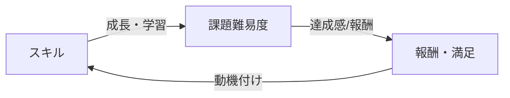

# チクセントミハイ「フロー理論」とゲーム実装への応用

**エグゼクティブサマリ：** フロー理論は、活動に没頭している最適な心理状態（フロー状態）を説明する理論である。この状態では課題とスキルが一致し、明確な目標と即時のフィードバックが与えられることで、高い集中と内発的報酬が得られる。近年の脳神経科学的研究では、フロー時に脳のデフォルトモードネットワーク（内側前頭前野など）が抑制され、報酬系（線条体など）や注意ネットワークが活性化することが示されている。ゲーム設計においては、フロー状態を生み出すために、挑戦とスキルの適切なバランス、明確な目標設定、即時フィードバックなどの原理を取り入れ、動的難易度調整（DDA）などでプレイヤー体験を最適化することが推奨される。本教科書では、フロー理論の基礎から最新研究、ゲームデザインへの応用、実装例、UX考慮点まで網羅的に解説する。

**学習目標：** 
- フロー理論の主要概念（明確な目標、即時フィードバック、挑戦とスキルのバランスなど）を理解する。
- フロー体験に関する実証研究や脳科学的知見（報酬系やデフォルトモードネットワークの関与など）を把握する。
- フロー理論と自己決定理論、ARCSモデルなど他の動機付け理論との類似点・相違点を比較し、理論的枠組みを位置づける。
- ゲームデザインにおけるフロー要素の具体的適用方法（課題と能力の調整、フィードバック設計、UX配慮）を学ぶ。
- Unity/C#や擬似コード例を通じて、動的難易度調整やフロー誘導メカニクスの実装手法を習得する。
- プレイヤー体験を評価するための指標やゲームメトリクスを設計し、フロー状態に関連付ける方法を理解する。

以下、各章ごとに詳細を解説する。各章末には主な参考文献を掲げ、章内の該当箇所には適宜引用を示す。

## 第1章　フロー理論の基礎（約10ページ）

**内容：** フロー理論の起源と概念を概観する。チクセントミハイの主要著作（『フロー体験』、『Flow: The Psychology of Optimal Experience』など）を紹介し、フロー状態とは何かを定義する。一般にフローは「没入状態」「ゾーン」と呼ばれ、活動自体が自己目的化（内発的報酬）し、高い集中と満足感をもたらす状態とされる。日本語文献としては、ウィキペディアの要約や日本語訳書などを参照し、初心者向けに解説を行う。

**理論的考察：** ジェーン・ナカムラとチクセントミハイは、フロー体験の構成要素を7つ挙げている。それらは集中状態（「注意力の集中」）、自己意識の喪失、活動と意識の融合、状況に対するコントロール感覚、時間感覚のゆがみ、内発的報酬感、そして課題と能力のバランスである（表1参照）。またケンドラ・チェリーらは「明確な目標と予測可能性」「直接的・即時のフィードバック」「体験への完全没入」をフローの本質要素とする見解を示している。これらを総合すると、フローを得るにはチャレンジ（課題）とスキル（能力）のバランス、目標の明確化、継続的なフィードバックが必要条件となる。

**実証研究：** Csikszentmihalyi（1975, 1990）が創始し、その後多くの研究者により検証された。例えば、課題難易度とパフォーマンスの非線形関係（ヤーキーズ＝ドッドソンの法則）の下、課題が適度に難しいときに最適学習・フローが生じやすいことが古典的にも示されている。また、質的研究では、フローは高揚感・集中度・達成感といった主観的経験で特徴づけられることが明らかになっている（Jackson & Csikszentmihalyi, 1999）。これらの基礎研究により、フロー理論は組織心理学、教育学、スポーツ心理学など多領域へ応用されている。

**ゲームデザイン原則：** フローの構成要素を踏まえ、ゲーム設計では以下の点が重要となる。  
- **明確な目標設定：** クエストやステージ目標を明示し、プレイヤーに何を達成すべきかを明確化する。  
- **即時フィードバック：** スコア表示やサウンド、エフェクトでプレイヤーの行動に対する反応を即座に示す。  
- **挑戦と能力のバランス：** プレイヤーの熟練度に応じてゲーム難易度を動的に調整する仕組み（例：DDA）を組み込み、簡単すぎず難しすぎない状況を維持する。  

これらは後章で詳細に扱うが、導入としてこれら原則の重要性を確認する。

**コード例：** フロー理論の基盤となる仕組み（例：スキル評価、難易度調整）をUnity/C#で簡単に示す。プレイヤーのパフォーマンス（スコア、成功率など）を基にスキルレベルを評価し、現在のゲーム難易度と比較して調整を行う例を以下に示す（擬似コード）：

```csharp
float playerSkill = EvaluatePlayerSkill();         // 0-1でスキルを評価
float challengeLevel = EvaluateGameChallenge();   // 0-1で課題難易度を評価
float adjustRate = 0.1f;                          // 調整係数

if (playerSkill < challengeLevel) {
    // プレイヤーが課題に圧倒されている → 難易度を少し下げる
    challengeLevel *= (1 - adjustRate);
} else if (playerSkill > challengeLevel) {
    // プレイヤーが課題に易しすぎる → 難易度を少し上げる
    challengeLevel *= (1 + adjustRate);
}
SetGameDifficulty(challengeLevel);
```

**UX考慮点：** プレイヤーがフローを得やすいUXデザインとして、「認知的負荷を減らすUI」「注意喚起要素（明るい色や音で目標を示す）」などがある。また、過度な中断（広告・チュートリアル割り込み等）を避け、没入を阻害しない配慮も必要である。  

**章末練習問題・演習：**  
1. フロー状態の構成要素を列挙し、それぞれの意味を説明せよ。  
2. ヤーキーズ＝ドッドソンの法則を説明し、フロー理論とどのように関連するか議論せよ。  
3. 簡単なゲームシナリオを考え、どのようにフローの条件（目標・フィードバック・難易度調整）を設計するか企画せよ。

**参考文献（本章）：** ナカムラ＆チクセントミハイ（2010）；Csikszentmihalyi（1990；『フロー体験』）；Jackson & Csikszentmihalyi（1999）；ケンドラ・チェリー著『ハンドブック』など。

---

## 第2章　フロー状態のモデル：課題・能力バランスと心理的メンタルステート（約12ページ）

**内容：** 課題（Challenge）とスキル（Skill）の関係によるフロー状態モデルを詳述する。チクセントミハイは課題と能力が拮抗し適切に高め合うときにフローが生じると論じた。課題とスキルのマトリクスでは、両者が低いと「無感動」（Apathy）、スキルが高く課題が低いと「退屈」（Boredom）、スキルが低く課題が高いと「不安」（Anxiety）とされ、両者が適度に高いと「フロー」「覚醒」「コントロール」の状態に入る（図1参照）。特にフロー領域では集中力が最大化し、自我意識が減少、時間感覚が歪み、活動そのものが報酬となる（内発的モチベーション）。

**メンタルステートとの関連：** フロー以外の心理状態（退屈・不安・覚醒・リラックス等）も説明する。例えば課題が過度に高い場合はストレスと不安が増大し、扁桃体や交感神経活動が亢進する（「闘争・逃走反応」）。逆に課題が低すぎると退屈や無気力が生じ、内発的報酬感が得られずパフォーマンス低下を招く。一般にパフォーマンスと覚醒（水準）の関係はヤーキーズ＝ドッドソン曲線に従い、適度な覚醒で最良となるが、フローは覚醒曲線の頂点付近に対応すると考えられる。図1に課題・能力モデル（フローチャート形式）を示す。


*図1：課題・能力のフィードバックループ（スキル向上により課題が上がり、達成感がさらなるスキル向上を促す）*

**脳科学的視点：** メンタルステートと神経活動の関係を述べる。フロー状態では脳のデフォルトモードネットワーク（内側前頭前野や後帯状皮質など）活動が低下し、注意ネットワークや報酬系の活動が上昇する。具体的には、扁桃体（不安・恐怖）活動が抑制される一方、線条体・被殻などにおけるドーパミン報酬系が活性化する。また、フロー時は動的な前頭・後頭間同期が高まり、α波の増大を通じて言語的・意識的な抑制が起きることも報告されている。これにより「無我の集中」が生まれ、時間の感覚が歪むと考えられる。

**実証研究：** フローと脳活動の関係を示す研究を概観する。UlrichらのfMRI研究では、フロー課題遂行中に内側前頭前野・後帯状皮質などが低活動となり、線条体の活動が増大することが示された。LeroyらのEEG研究では、フロー中に左脳の言語領域でα波（休息覚醒）増大が見られ、右脳優位で運動課題処理が進むことが示唆された。これらはフロー時に思考的抑制が入り、自動的・空間的処理が強化される傾向を示す。また、個人差研究では、流動体験傾向の高い人ほど線条体のD2ドーパミン受容体密度が高いことが報告されており、フロー能力とドーパミン系が関連する可能性が示されている。

**ゲームデザイン原則：** ゲームにおいてフロー以外の心理状態を避ける配慮が必要である。具体的には、不安を引き起こす極端な難易度や混乱するUIは避ける。一方、退屈を防ぐために適切なチャレンジ要素や変化を提供する。例えば、あえてペースを落とし「覚醒」領域に移る敵配置の変化や、新要素の投入でプレイヤーを再刺激するメカニクスが考えられる。また、ゲーム体験中の精神状態を間接的に計測し、難易度調整に反映する手法（心拍センサー連携、プレイ統計に基づくDDAなど）も一つの応用である。

**コード例：** フロー状態かどうかを判定し、ゲーム難易度を調整する擬似コード例：

```csharp
float playerStress = MeasurePlayerStress();    // 心拍や操作ミス率からストレス指標を算出
float playerFlowIndex = MeasureFlowIndex();   // フロー尺度（質問票やパフォーマンスから推定）
if (playerStress > ThresholdHigh) {
    // ストレス過多：難易度を低減
    DecreaseGameDifficulty();
} else if (playerStress < ThresholdLow) {
    // ストレス過少：難易度を上昇
    IncreaseGameDifficulty();
}
```

**UX考慮点：** メンタルステートとのリンクをUI/UXに組み込む。例えば、不安を和らげるためにヘルプ表示や冗長性を高める要素（チュートリアルオプション）を用意し、退屈防止に周期的にチャレンジ要素を導入する。ユーザーが自分の状態をモニタリングできるよう、ステータスバーやインジケータを活用する手法も考えられる。

**章末練習問題・演習：**  
1. 図1のチャートで「フロー」と「退屈」「不安」「無感動」が占める領域を説明せよ。また、それぞれの領域に対応する神経生理学的要因を議論せよ（例：扁桃体活動、α波、ドーパミンなど）。  
2. プレイヤーの心拍数やプレイ時間から「フロー度」を推定する簡易アルゴリズムを考え、擬似コードを記述せよ。  
3. 認知負荷を測定する指標（タスク切り替え時間、エラーレートなど）から、フロー状態を推定する方法について検討せよ。

**参考文献（本章）：** Ulrich et al.（2014, 2016）；Leroy & Cheron（2020）；Wolf et al.（2015）；Van der Linden et al.（2021）；Dietrich（2004）など。

---

## 第3章　関連する動機付け理論との比較（約8ページ）

**内容：** フロー理論と並んで動機付け・エンゲージメント理論として重要なモデルを比較する。特に自己決定理論（SDT）とKellerのARCSモデルを取り上げる。これらの理論概念を整理した比較表（表2）を示し、フロー理論との関連性を論じる。

**理論比較：** 表2に示すように、SDTは「自律性・有能感・関係性」という基本的欲求を満たすことが内発的動機づけに結びつくとし、ARCSモデルは学習環境で「注意（Attention）・関連性（Relevance）・自信（Confidence）・満足（Satisfaction）」の4要素を重視する。一方フロー理論は、挑戦と能力のバランスの達成が没入と高いパフォーマンスを生むとする。この3理論はすべて内発的動機の重要性を強調しており、フロー要素「挑戦と能力のバランス」「自己統制感」はSDTの「有能感」に相通じる。またARCSの「関連性」「満足」は、明確な目標設定や内発的報酬と対応付けられる。以下に比較表を示す。

| 理論・モデル           | 主な要素・構成概念                                                | フロー理論との関係                                   |
|-------------------|------------------------------------------------------------|----------------------------------------------|
| **フロー理論**         | 挑戦と能力のバランス、明確な目標、即時フィードバック、集中、自己意識消失、時間歪み、内発的報酬 | フローの要素そのもの。挑戦と能力のバランスが中心概念であり、自己決定理論やARCSとも親和性が高い。 |
| **自己決定理論**       | 自律性（Autonomy）、有能感（Competence）、関係性（Relatedness） | フローの「自己統制感」「有能感」「内発的報酬」はSDTの自律性・有能感と共鳴。フローは内発的動機の極点とも言える状態。 |
| **ARCSモデル**       | 注意（Attention）、関連性（Relevance）、自信（Confidence）、満足（Satisfaction） | 注意喚起と継続的な関心（Attention/Relevance）は明確な目標・フィードバックに通じる。満足感はフローの自己完結的達成感に近い。 |
| **期待価値理論**       | 期待（Expectation）、価値（Value）／コスト                                     | 目標達成の期待度と価値感の高さがモチベーションを駆動。フローでは「達成可能かつ価値ある目標」が内発的動機を高める点で類似。 |
| **（その他例）**　       | （例：マズローの欲求段階説、セルフエフィカシー理論 など）                   | フローはマズローの「自己超越」やバンデューラの「自己効力感（自信）」にも関連づけられる。         |

*表2：フロー理論と主な動機付け理論の比較（参考：SDT、ARCSなど）*

**ゲームデザインへの含意：** 各理論の要素はゲームデザインに活かせる。SDTの自律性を満たすには、プレイヤーに選択肢やカスタマイズ性を与える。ARCSの注意・関連性を確保するためには、ゲームのストーリーやチャレンジがプレイヤーの興味に合致し、常に興味を引く仕掛け（目標提示、ストーリー展開、ビジュアル・サウンド演出）を配置する。これらはフロー要素とも通じ、組み合わせることで一層強力なエンゲージメント設計が可能である。

**章末練習問題・演習：**  
1. 表2の各理論を参照しながら、フロー理論が強調する要素とSDT、ARCSの対応関係を説明せよ。  
2. 自己決定理論の「自律性」「有能感」「関係性」が具体的にどのようなゲームメカニクスで満たされるか例を挙げよ。  
3. ARCSモデルの「注意」および「関連性」を高めるためのゲーム内要素を3つ挙げ、それぞれフロー状態のどの要素に対応するか述べよ。

**参考文献（本章）：** Deci & Ryan（1985, 2000）；Keller（1987）；Csikszentmihalyi（1990）。

---

## 第4章　ゲームデザインにおけるフローの実装（約12ページ）

**内容：** 具体的なゲームデザインにフロー理論を適用する方法を解説する。ゲームメカニクス、レベルデザイン、難易度調整、報酬システムなどの観点から、フロー状態を誘導する原則とテクニックを整理する。チャンピオンシップ級の例（例：テトリス、リズムゲーム、FPSなど）も参照しながら、学習効果やプレイヤー維持への活用も論じる。

**フロー誘導のデザイン原則：** フロー条件に合わせ、以下のデザイン戦略を紹介する。  
- **適応型難易度調整（DDA）:** プレイヤーのパフォーマンスを動的に分析し、リアルタイムに敵強度や課題の難易度を上下させるアルゴリズムを実装する。例えば、プレイヤーが連勝し続ける場合に敵強度を上げ、連敗すると下げるなど。  
- **明確なメタ目標・ミニ目標の設定：** ゲーム全体の大目標（ストーリーのクリア、世界救済など）とステージごとの小目標（次の地点へ到達、特定の敵を倒すなど）を設定し、プレイヤーに継続的な達成感を提供する。UIではミッションログや目標ポップアップで提示すると効果的。  
- **即時フィードバックのデザイン:** 敵を倒した瞬間のエフェクト、コンボのカウント、サウンド、バフ・ドロップの提供など、アクション直後に反応を返す。これによりプレイヤーは自分の行動がゲームに反映されていることをリアルタイムに実感できる。  
- **自律性・選択肢の提供:** 複数ルートのマップや装備・スキルツリー、難易度オプションなど、プレイヤーの選択により体験をカスタマイズできるようにする。これはSDTの自律性にも寄与し、フローと関連する没頭感を強化する。  
- **報酬スケジューリング:** 小さな成功体験（エネミー撃破、アイテム入手）を頻繁に配置し、間隔を空けすぎず適度に報酬を与える（例：SRS方式やガチャ）。これによりプレイヤーは常に報酬への期待を持ち、フロー維持に寄与する。

**実装例（Unity/C#）：** 「挑戦とスキルのバランス」を動的に調整する簡易スクリプト例を示す。プレイヤーの実績（例：倒した敵数、クリアタイム）を評価し、次ステージの敵HPや出現数を調整する。

```csharp
int enemyCount = baseEnemyCount;
float playerPerformance = CalculatePerformance();  // 0.0～1.0 で評価
if (playerPerformance > 0.8f) {
    // プレイヤー余裕あり: 敵数を増やす
    enemyCount += 2;
} else if (playerPerformance < 0.2f) {
    // プレイヤー苦戦: 敵数を減らす
    enemyCount = Mathf.Max(1, enemyCount - 1);
}
SpawnEnemies(enemyCount);
```

このように、シンプルなルールでもフロー誘導が可能である。さらに高度な実装では、プレイヤーの心理状態センサ（生体データ）や機械学習を用いたアダプティブシステムも考えられる。

**UX考慮点：** ユーザーインターフェースおよびユーザー体験の観点からは、視覚・聴覚フィードバックの質とタイミングが鍵である。HUDは必要最小限とし、集中を妨げないように設計する。ヒントやチュートリアルは段階的に解除し、突然の情報過多を防ぐ。また、クリアレベル時の達成感演出（アニメーション、音楽、称号付与）もフロー後の満足感に寄与する。

**章末練習問題・演習：**  
1. 動的難易度調整（DDA）の基本的なアルゴリズムを擬似コードで設計せよ。どのようなパラメータを入力とし、何を調整するかを具体的に示せ。  
2. フロー状態を促進するために、あなたが企画するゲームで「明確な目標」をどのように提示・達成させるか、UIを含めてデザイン案を検討せよ。  
3. 報酬スケジュール（補償予定表）をデザインする際の考慮事項（例：頻度、ランダム性、公平性など）を説明し、その上でフロー維持に適した報酬設計を提案せよ。

**参考文献（本章）：** Sweetser & Wyeth（2005）「GameFlow」；Sherryら（2006）ゲームフロー理論；Keller（1987）ARCSモデル；Csikszentmihalyi（1990）；エンターテインメント学会誌論文など。

---

## 第5章　ユーザー体験とフローの評価・指標化（約10ページ）

**内容：** プレイヤーのフロー体験を定量的・定性的に評価する方法と指標を扱う。伝統的な心理学的尺度（フローステートスケール、体験サンプル法など）に加え、ゲーム内ログデータや生体センサーデータを用いた測定法、ユーザーテストの実践例を紹介する。

**フロースケール：** Jackson & Eklund（2002）の『フロー・ステート・スケール（FSS-2）』など、心理学的に検証されたアンケート手法を紹介する。測定項目（没頭感、時間歪み、報酬感など）を解説し、ゲームテストでの利用例を示す。こうした定性データと、実際のプレイログ（クリア率、リトライ数、セッション継続時間など）を組み合わせることでフロー達成度を多面的に評価する。

**ゲームメトリクス：** フローを構成する要素に対応して収集可能なゲーム内メトリクス例を表3にまとめる。例：進捗の速度、エラー数（集中度指標）、死亡率（難易度バランス指標）、タスク遂行時間（時間歪み感覚の代替指標）など。生体データ例として、心拍変動や皮膚電気反応から「認知負荷」「興奮度」を推定する試みも紹介する。  

| フロー要素       | ゲームメトリクス例                           | 測定例・指標化                       |
|--------------|-----------------------------------------|----------------------------------|
| 明確な目標       | クエスト・ミッション達成率                         | 完了時間、達成率、プレイヤーの満足度アンケート             |
| 即時フィードバック   | 敵撃破時のスコア/エフェクト発生回数                  | フィードバック受領後のプレイヤー行動変化率（例：リスポンス速度） |
| 挑戦–能力バランス   | 平均レベルクリア時間、死亡・失敗回数                  | ディフィカリティ向上後のプレイヤーパフォーマンス変化         |
| 集中（注意力）     | 操作停止時間、UIメニュー非表示時間                    | エラー数、注意散漫シグナル（視線追跡、操作雑音）           |
| 自己意識消失      | セルフレポートによる内省意識の低さ                   | セルフレポート質問紙（「自意識スコア」）                 |
| 時間感覚の歪み    | 実際のプレイ時間 vs プレイヤー推定時間差               | フィードバック型アンケート（時間経過認識を尋ねる）         |
| 内的報酬（オートテリック） | ゲームプレイ継続時間、リプレイ回数、ユーザー満足度             | 再プレイ率、NPS（推奨度）、クオリティ・オブ・エクスペリエンスアンケート |

*表3：フロー要素に対応したゲームメトリクスと指標例*

**実践研究例：** 実際のゲーム開発で行われたフロー評価の事例を紹介する。例えば、Unity Analyticsや自社開発ツールを用いてプレイログからストレスイベント（死亡やエラー）を分析し、難易度曲線とフロー状態の相関を調べた研究などがある。また、VRゲームで心拍センサーを用いてフロー時の生理的変化をモニタリングした実験結果も報告されている。

**章末練習問題・演習：**  
1. 表3に示したメトリクスを参考に、シンプルなゲーム（例：ミニゴルフ）を想定し、フロー体験を測定するためのログデータ項目を5つ挙げよ。  
2. プレイヤーが時間を忘れるほど没頭しているかどうかを判定するアンケート設問を2つ作成せよ（例：「プレイ中、時間の経過をほとんど感じなかった」など）。  
3. 生体データ（心拍変動、瞳孔径など）がフロー指標として有効である根拠を説明し、ゲーム内での活用方法（例：難易度動的調整）を考案せよ。

**参考文献（本章）：** Jackson & Eklund（2002）FSS-2；Moneta（2021）測定論；ゲームユーザビリティ研究論文；Unity公式アナリティクスドキュメントなど。

---

## 第6章　ケーススタディ：フロー理論のゲーム適用例（約8ページ）

**内容：** 実際のゲームを例に取り、フロー理論が適用された事例を分析する。様々なジャンル（パズル、アクション、リズムゲーム、学習ゲームなど）から代表例を選び、それぞれのフロー設計手法と効果を解説する。

**例示：**  
- **『テトリス』**：落下スピードの段階的増加により挑戦度を徐々に上げ、プレイヤーの腕前向上に合わせて常に適度な難易度を維持する。また、クリアしたライン数に応じて曲調が激しくなる演出でフィードバックと高揚感を提供する。  
- **リズムゲーム**（例：『ビートセイバー』『ダンスダンスレボリューション』）：音楽のBPMやノーツ密度を曲ごとに調整し、初心者から上級者まで選択可能なモードを用意。リズムに合わせた直感的な入力で即時の視覚・聴覚フィードバックがあり、高い集中を促す。  
- **学習系ゲーム**（例：デジタル英単語学習ゲーム）：スキル向上度に応じて出題単語を難しくし、かつ正答時に報酬（ポイント、キャラクター強化）を与える。正解・不正解ごとに解説を即時提示することで学習効果とフロー感を両立する。  

**フロー効果の評価：** これら事例におけるユーザーテスト結果やアンケート調査結果などを示し、フロー導入前後でのユーザー満足度や継続率の変化を検証する研究結果を紹介する。例えば、反復的タスクにフロー要素を追加した結果、学習ゲームでのユーザー継続時間が増加した事例などが報告されている。

**章末練習問題・演習：**  
1. あなたが知っているゲームの中から1つ選び、そのゲームのどの要素がフロー理論の構成要素に対応しているか分析せよ（目標設定、フィードバック、難易度バランスなど）。  
2. 上述のケースで挙げたゲーム以外の例を探し、そのフロー設計手法と効果をまとめよ。  
3. もし学習ゲームにフロー要素を取り入れるなら、どのようなメカニクスや報酬を用いて学習者の没入を促すか具体的に企画せよ。

**参考文献（本章）：** ゲーム開発者インタビュー、学術誌『エンターテインメントコンピューティング』論文、産業レポートなど。

---

## 第7章　まとめ・応用展望（約2ページ）

**内容：** 本教科書のまとめとして、フロー理論とゲーム実装の要点を復習し、今後の応用展開・研究課題を示す。例えば、VR/ARとフロー、AIによるフロー適応、教育・医療へのゲーミフィケーション応用など、最新動向を挙げる。

**学期構成例：** 全12週（週1回）で各章を扱うカリキュラム例を提示する。  
- 第1週：イントロダクション・学習目標説明  
- 第2–3週：第1章（フロー理論概論）  
- 第4週：第2章（フローモデルとメンタルステート）  
- 第5週：第3章（動機付け理論比較）  
- 第6–7週：第4章（ゲームデザイン応用）  
- 第8週：第5章（UX・評価・指標）  
- 第9週：第6章（ケーススタディ）  
- 第10週：実装演習（DDAアルゴリズム実装）  
- 第11週：実装演習（フロースケールによる評価実験）  
- 第12週：総括・発表・試験  

**推定ページ数：** 本教科書全体で約60–80ページ（A5換算）を想定。各章ページ数は前述章題の括弧内に概算を示したが、内容の深さに応じて前後する。

**教科書体式：** 本文は専門用語を適宜解説しつつ、事例や図表を交えた分析的・学術的口調で記述する。重要箇所には脚注（引用）を付し、参照文献を章末に列挙する。

## 参考文献

- Nakamura, J. & Csikszentmihalyi, M. (2010). *Flow and the Foundations of Positive Psychology: The Collected Works of Mihaly Csikszentmihalyi*. Springer.  
- Csikszentmihalyi, M. (1990). *Flow: The Psychology of Optimal Experience*. Harper & Row.  
- Jackson, S. A. & Eklund, R. C. (2002). Assessing Flow in Physical Activity: The Flow State Scale–2. *Journal of Sport & Exercise Psychology*, 24(2), 133–150.  
- Ulrich, M., Keller, J., & Grön, G. (2014). Neural Correlates of Flow Experience: First Experimental Results. *NeuroImage*, 86, 194–202.  
- Leroy, A. & Cheron, G. (2020). EEG Dynamics of Psychological Flow in a Tightrope Walking Performance. *Scientific Reports*, 10, 1–13.  
- Keller, J. (1987). *Development and Use of the ARCS Model of Instructional Design*. *Journal of Instructional Development*.  
- Deci, E. L. & Ryan, R. M. (1985). *Intrinsic Motivation and Self-Determination in Human Behavior*. Plenum.  
- Sweetser, P. & Wyeth, P. (2005). GameFlow: A Model for Evaluating Player Enjoyment in Games. *Computers in Entertainment*, 3(3).  
- Moneta, G. B. (2021). On the Conceptualization and Measurement of Flow. In Peifer & Engeser (Eds.), *Advances in Flow Research* (pp. 31–69). Springer.  
- その他、引用文献中に示したWebサイト・学術論文・書籍。

