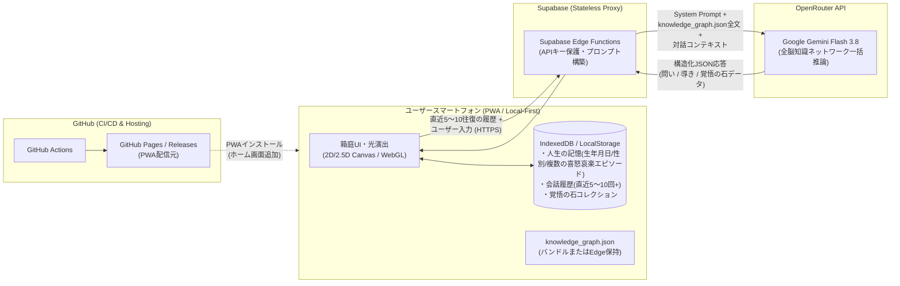
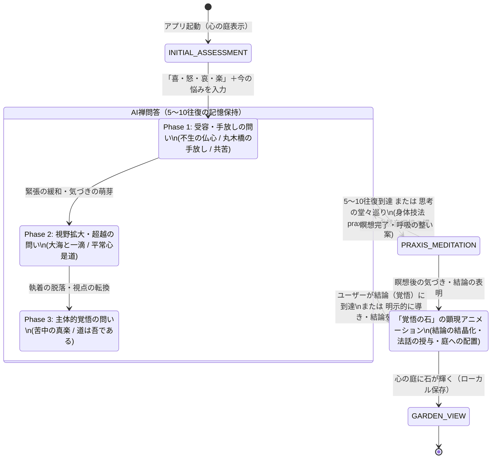

# 円覚寺禅問答・心庭（箱庭）・瞑想PWAアプリ 設計仕様書

**Version:** 2.0  
**更新日:** 2026年11月9日  
**開発対象:** スマートフォン特化型 プログレッシブWebアプリ（PWA）  
**基本思想:** 問い、沈黙、観察、手放し、そして「覚悟の石」の顕現（フロー理論と円覚寺全脳知識ネットワークの融合）

---

## 第1章 アプリの目的とコア体験（UX洞察）

### 1.1 コンセプト
本アプリは、臨済宗大本山円覚寺の法脈（朝比奈宗源老師、横田南嶺老師、盤珪永琢禅師の不生禅）を体系化した**「全脳知識ネットワーク（`knowledge_graph.json`）」**を知識基盤とし、AIとの禅問答・自然音による身体技法（瞑想）・光と陰影の「心の庭（箱庭）」を融合させた自己省察・フロー体験アプリである。

通常のAIチャットのように即席の正解を与えるのではなく、**5〜10往復の問答を通じてユーザー自身の内なる気づきを促し、最終的にユーザーが自らの肚（はら）を据えて導き出した結論を「覚悟の石」として心の庭に結晶化・発光させる**ことで、深い自己変容と没入（フロー）をもたらす。

### 1.2 チクセントミハイ「フロー理論」に基づく没入設計
`deep-research-report.md` で考察されたフロー理論および神経科学的知見（デフォルトモードネットワーク［DMN：反芻思考や過度な自意識］の抑制と、内発的報酬系の活性化）を、禅の体験プロセスに以下のように統合する。

1. **課題と能力の動的バランス（Dynamic Difficulty Adjustment: 問答の3フェーズ遷移）**
   - 苦悩の渦中にあるユーザー（高ストレス・扁桃体過活動状態）にいきなり厳しい公案を突きつけると「不安（Anxiety）」に陥り、逆に表層的な慰めだけでは「退屈（Boredom）」を生む。
   - そのため、`knowledge_graph.json` の `transforms_to_ids` に定義された **Phase 1（受容・手放し）→ Phase 2（視野拡大・生死や自他の超越）→ Phase 3（主体的覚悟・苦中の真楽）** の3段階に沿って、ユーザーの「人生の記憶（生年月日・性別などの任意属性＋これまでに経験した複数の喜怒哀楽エピソード）」や直近5〜10回の回答の深まりに応じた問いの強度調整（DDA）を行う。
2. **認知負荷の極小化と環境への完全没入**
   - 複雑なメニューや統計グラフを排し、落ち着いた光と影が揺らぐ「心の庭」のビジュアルと、最小限のテキスト・環境音のみで構成する。これにより脳の言語的・分析的な過剰防衛（DMN）を鎮め、「今ここ」の対話に集中させる。
3. **即時フィードバックと「覚悟の石」による内発的報酬（Autotelic Experience）**
   - ユーザーの1回ごとの発言に呼応して庭の「光のゆらぎ（波紋や灯り）」が微細に変化する即時フィードバックを与える。
   - そして問答の果てにユーザー自身が「自分の結論（覚悟・気づき）」を見出した瞬間、それが光り輝く**「覚悟の石」**としてアニメーションと共に庭に立ち上がる。この視覚的・精神的なカタルシスが強力な内発的報酬となり、ゲーム感覚の達成感と実存的な肚の据わりを両立させる。

---

## 第2章 システムアーキテクチャと配布・データ保存仕様

### 2.1 全体アーキテクチャ図



### 2.2 PWA配布とインストール仕様（GitHub連携）
* **ビルド・配信基盤:** GitHub Actions による自動ビルドパイプラインを構築し、**GitHub Pages**（または GitHub Releases からの静的アセット配信）をPWAのダウンロード・インストール先として指定する。
* **スマートフォンへのインストール:** Web App Manifest（`manifest.json`）および Service Worker を完備し、ユーザーのスマートフォン（iOS Safari / Android Chrome）の「ホーム画面に追加」からネイティブアプリ同等のフルスクリーン（`display: standalone`）で起動・動作する。
* **オフラインキャッシュ:** アプリの基本UI、箱庭のグラフィックアセット、環境音MP3、`knowledge_graph.json` は Service Worker により端末内にキャッシュされ、高速な起動とオフラインでの庭鑑賞・瞑想を実現する。

### 2.3 完全ローカルデータ保存（プライバシー・バイ・デザイン）
* **サーバー側DB不使用（Stateless Backend）:** ユーザーの個人情報、悩み、対話履歴、獲得した「覚悟の石」、箱庭の状態など、**ユーザーに関するあらゆるデータはユーザーのスマートフォン内部（IndexedDB および LocalStorage）にのみ保存される。**
* Supabase 側のデータベース（PostgreSQL等）にはユーザーの会話ログや個人データを一切保存しない。Supabase は純粋に Edge Functions による API キー秘匿とリクエスト中継のためにのみ機能する。

### 2.4 LLM推論基盤（Supabase Edge Functions × OpenRouter × Gemini Flash 3.8）
* **エンドポイント:** フロントエンドPWAからは Supabase Edge Functions のみを呼び出す。
* **OpenRouter 連携:** Edge Functions 内部に `OPENROUTER_API_KEY` を環境変数として安全に格納し、OpenRouter の Chat Completions API（`https://openrouter.ai/api/v1/chat/completions`）を叩く。
* **指定モデル:** Google の **`Gemini Flash 3.8`**（OpenRouter上の対応モデルIDを指定、環境変数で切り替え可能）を使用する。高速なレスポンスと長大なコンテキスト処理能力を活かし、対話のテンポ（フロー）を損なわない設計とする。

---

## 第3章 全脳知識ネットワーク（`knowledge_graph.json`）と対話コンテキスト設計

### 3.1 `knowledge_graph.json` 全文包括インジェクション
Gemini が回答・問いを生成する際、 부분検索（RAGのチャンク切り出し）による文脈欠落を防ぐため、**`knowledge_graph.json` のデータ全体をシステムプロンプト（またはコンテキスト）にまるごと包括して Gemini Flash 3.8 に投げる（Full-Context Injection）**。

`knowledge_graph.json`（約450行）に含まれる以下の5大要素すべてを Gemini が常に俯瞰した状態で推論を行う：
1. **`masters`（禅師・管長）:**
   - 朝比奈宗源（仏心の信心、苦中の真楽、肚を据える覚悟、道は吾である）
   - 横田南嶺（不生の受容、共苦［コンパッション］の慈悲、身体呼吸への委ね、和の精神）
   - 盤珪永琢（不生の仏心で一切の事は調う）
2. **`sufferings`（6つの苦悩類型と3段階の転換パス `transforms_to_ids`）:**
   - `Suf_Anxiety`（焦燥・自己無価値感）
   - `Suf_Grief`（死別・喪失の悲嘆）
   - `Suf_FearOfFailure`（重責・失敗の恐怖）
   - `Suf_Isolation`（孤立感・承認渇愛）
   - `Suf_Decline`（心身の衰え・老病の苦）
   - `Suf_PerfectionismBurnout`（完璧主義・燃え尽き）
3. **`wisdoms`（7つの智慧の境地）:**
   - `Wis_UnbornMind`（不生の仏心）、`Wis_OceanAndDrop`（大海と一滴の生命）、`Wis_RealJoyInPain`（苦中の真楽・道は吾である）、`Wis_GreatCompassion`（共苦の慈悲・入鄽垂手）、`Wis_FlowerLife`（花のように生きる）、`Wis_LettingGoBridge`（丸木橋の手放し）、`Wis_OrdinaryMindSamu`（平常心是道）
4. **`discourses`（具体的な法話・語録・出典URL・トーン）:**
   - 丸木橋と蒲団の譬え、老農婦の問い、大海の泡、落ち葉掃きの作務など、10編の核心的法話。
5. **`praxes`（7つの身体技法・呼吸法・作務）:**
   - 立腰・丹田呼気充実、無意識呼吸への帰依、掃き清めの作務、合掌・感謝の言霊、イス坐禅、朝の立腰念誦法、丸木橋の手放し（脱力と蒲団の瞑想）。

### 3.2 「人生の記憶（喜怒哀楽エピソード群）」と直近5〜10往復の対話記憶
* スマートフォン側からリクエストを送る際、ユーザーが「人生の記憶」として記録したプロフィール情報（任意の生年月日・性別、および5個〜10個以上登録可能な「喜・怒・哀・楽」の人生経験エピソード群）と今回のテーマに加え、**直近5〜10往復分のユーザー回答とAIの問いの履歴**を常にペイロードに含めて送信する。
* これにより、Gemini は「ユーザーが最初の1往復目からどのように言葉を変え、どこに執着し、どのフェーズ（Phase 1: 受容 → Phase 2: 超越 → Phase 3: 覚悟）まで心が動いてきたか」を一貫して記憶・追跡しながら、知識ネットワーク内の最適な `wisdoms` / `discourses` / `praxes` を選び取って応答を生成する。

---

## 第4章 UI/UXデザイン：光と陰影の「心の庭」と「覚悟の石」

### 4.1 ビジュアルコンセプト：「静謐な光（ライト感覚）」と箱庭
* **表現手法:** 重厚すぎる3Dモデルではなく、スマートフォンで軽快かつ美しく動作する**高品質な2D/2.5Dレイヤー表現（イラストレーション＋Canvas/WebGLシェーダーによる光・パーティクル演出）**、あるいはミニマルで洗練されたローポリゴン/アイソメトリック箱庭を採用する。
* **光の配色（ライト感覚）:**
  - 画面全体は「夜の静寂から暁（あかつき）へ」「木漏れ日と苔の陰影」を思わせる、彩度を抑えた深い藍色・墨色・温かみのある琥珀色（アンバー）・淡い月白（げっぱく）を基調とする。
  - ユーザーの目に負担をかけず、暗い部屋でスマートフォンを見つめても心が鎮まる「落ち着いた光のグラデーションと微細な光の粒子（ホタルや露のきらめきのようなパーティクル）」を常時ゆったりと漂わせる。

### 4.2 対話に連動する光のフィードバック
* **呼吸する光:** AIの問いが提示されるとき、またユーザーが言葉を紡ぐとき、箱庭の中央や水面が呼吸するように淡く明滅し、波紋が広がる。
* **フェーズに応じた庭の空気感:**
  - **Phase 1（受容・手放し）:** 柔らかく包み込むような淡い琥珀色・月光の色調。
  - **Phase 2（視野拡大・大海と一滴）:** 水面や空の広がりを感じさせる深い蒼と澄んだ光の粒子。
  - **Phase 3（主体的覚悟・道は吾である）:** 丹田の充実と夜明けを感じさせる、芯のある温かな金色の光。

### 4.3 クライマックス演出：「覚悟の石（Stone of Resolution）」の顕現
5〜10往復の問答を重ね（あるいは瞑想を経た後）、ユーザーが自分なりの結論・気づき・肚を決めた言葉（「〜してみようと思う」「もう手放していいのだと感じた」「自分の足で歩いていく」など）に到達した際、またはユーザーが結論のまとめを求めた際、**「覚悟の石」の生成イベント**が発生する。

1. **結論の結晶化アニメーション:**
   - ユーザーの結論（覚悟の言葉）と、それに呼応する円覚寺の智慧（`knowledge_graph.json` の `wisdoms` / `discourses` の一節）が重なり合い、画面中央で光の粒子が収束する。
2. **ピカピカと光る「覚悟の石」の立ち上がり:**
   - 心の中の庭（箱庭）の大地や水辺から、内側から神秘的な光を放つ**「覚悟の石」**が、心地よい音響エフェクトと光の波動（ブルーム効果・きらめきアニメーション）を伴って、ゲーム感覚のリッチな演出でスッと立ち上がる。
   - 石の色や輝き方・形状は、到達した智慧の属性（`orientation`: `accepting`［翡翠・琥珀の柔光］、`transcendent`［蒼백・瑠璃の煌めき］、`resolute`［黄金・紅蓮の力強い輝き］、`solidarity`［温かな桜色・乳白の光］）に応じて変化する。
3. **コレクションと振り返り（庭の成長）:**
   - 立ち上がった「覚悟の石」は箱庭の中に永続的に配置（ローカル保存）され、いつでも庭でピカピカと静かに輝き続ける。
   - ユーザーが庭の中の「覚悟の石」をタップすると、**「いつ、どんな苦しみ（`sufferings`）から、どのような問答を経て、どんな自分の結論（覚悟）に至ったか」**、そしてその時授かった**禅師の言葉（`quote` と出典URL）**が美しいカードとして浮かび上がる。
   - セッションを重ねるごとに心の庭に「覚悟の石」が増えていき、ユーザー自身の精神の軌跡が箱庭として可視化される。

---

## 第5章 ユーザー体験（セッション）の全体フロー



### 5.1 ステップ1：「人生の記憶」の蓄積と、今日のテーマ入力
* ホーム画面には独立した **「人生の記憶」ボタン** を配置し、ユーザーはいつでも自分自身のプロフィールやこれまでの人生経験をスマートフォン内に記録・追加できる。
  1. **基本属性（すべて任意）:** 生年月日（または年代）、性別、現在の歩み・背景（一言メモ）。
  2. **喜・怒・哀・楽の記憶（複数登録可能）:** 数値ではなく、人生の中で実際に経験した「喜んだこと（喜）」「怒ったこと・許せなかったこと（怒）」「悲しかったこと・喪失体験（哀）」「楽しかったこと・安らぐこと（楽）」のエピソードを、5個でも10個でも自由にカードとして蓄積できる。
* 禅問答を始める際は、蓄積された「人生の記憶」をベースとして自動参照しつつ、「今、心に引っかかっていること（今日のテーマ）」を入力するだけで即座に対話が開始される。
* この「人生の記憶」と「今日のテーマ」から、Gemini は `knowledge_graph.json` の `sufferings`（6つの苦悩類型）のうち最も近い状態像を内部推定し、その人の人生経験の文脈に沿った Phase 1 の問いを開始する。

### 5.2 ステップ2：全脳知識ネットワークに基づく5〜10往復の禅問答
* **1問1答の原則:** AIは1回につき1つの簡潔で深い問い（40〜120文字程度）を投げかける。
* **知識ネットワークの活用:**
  - 単なるオウム返しではなく、`knowledge_graph.json` の `discourses`（丸木橋の譬え、大海の泡、落ち葉掃き等）のモチーフを自然な現代語の問いに織り交ぜて投げかける。
  - 直近5〜10回のユーザーの回答履歴をすべて踏まえ、言葉の奥にある「力み」「自己否定」「過去や未来へのとらわれ」を優しく照らし出す。

### 5.3 ステップ3：身体技法（`praxes`）と自然音瞑想への移行
* 5〜10往復ほど対話が進んだ段階、またはユーザーが思考で行き詰まった段階で、AIは `knowledge_graph.json` の `praxes`（7つの身体技法）と自然環境音を組み合わせた小休止・瞑想を提案する。
  - 例：`Suf_PerfectionismBurnout`（完璧主義）のユーザーには、`Pra_OpenHandSurrender`（「丸木橋の手放し」：握りしめた両手のこぶしを開き、肩の力を落として息を吐く2分間の脱力瞑想）＋「雨音」や「波音」を提案する。
  - 例：`Suf_Anxiety`（焦燥）から覚悟へ向かうユーザーには、`Pra_TandenBreathing`（「立腰・丹田呼気充実」：腰骨を立て下腹に気力を満たす3分間の呼吸）＋「静寂」や「森の音」を提案する。
* 瞑想中はテキストUIがフェードアウトし、箱庭の光のゆらぎと自然環境音（雨、波、森、小川、静寂）だけに包まれる。

### 5.4 ステップ4：結論の導出と「覚悟の石」の誕生
* 問答（5〜10往復目安）や瞑想を通じて、ユーザーが自らの言葉で「気づき」や「決意（結論）」を語ったとき、あるいはユーザーが「今の自分の答えをまとめたい／導きがほしい」と求めたとき、セッションはクライマックス（`STONE_MANIFESTATION`）へ移行する。
* Gemini は直近5〜10往復の全履歴と `knowledge_graph.json` を照合し、以下を生成する：
  1. **ユーザーの結論の結晶（`resolution_title` / `resolution_summary`）:** ユーザー自身が辿り着いた覚悟の言葉の美しい要約。
  2. **呼応する円覚寺の法話（`matched_discourse`）:** `knowledge_graph.json` から選ばれた師家の言葉（`quote`、師家名、出典タイトル、URL）と、なぜその言葉が今のユーザーの結論と響き合うのかの温かい解説。
  3. **「覚悟の石」の視覚パラメータ（`stone_attributes`）:** 光の色、輝き方、対応する `wisdom_id`。
* 画面上で光のアニメーションが再生され、ピカピカと輝く「覚悟の石」が心の庭に立ち上がる。

---

## 第6章 AI推論とプロンプト・レスポンス仕様（Edge Functions 実装設計）

### 6.1 Supabase Edge Functions へのリクエスト形式（Frontend → Edge）

```typescript
interface ChatRequestPayload {
  assessment: {
    ki: number;   // 喜 (0-10)
    do: number;   // 怒 (0-10)
    ai: number;   // 哀 (0-10)
    raku: number; // 楽 (0-10)
    initialConcern?: string;
  };
  // 直近5〜10往復（最大20メッセージ）の対話履歴を常に送信
  history: Array<{
    role: "user" | "assistant";
    content: string;
    phase?: 1 | 2 | 3;
  }>;
  turnCount: number; // 現在の往復数（1〜10+）
  requestConclusion: boolean; // ユーザーが明示的に結論・導きを求めたか
}
```

### 6.2 システムプロンプト構成（Edge Functions → OpenRouter `Gemini Flash 3.8`）
Edge Function 内で以下の構造を持つシステムプロンプトを組み立てて OpenRouter へ送信する。

1. **役割定義と対話原則:**
   - 臨済宗円覚寺の法脈に連なる静謐で慈悲深い禅問答の伴走者。
   - 序盤〜中盤（1〜5往復目）は安易に結論を押し付けず、1回に1つの問いでユーザー自身の内省を深める。
   - ユーザーの直近5〜10回の回答の変遷を綿密に読み取り、Phase 1（受容）→ Phase 2（超越・視野拡大）→ Phase 3（主体的覚悟）へと導く。
   - 5〜10往復の中でユーザーが自ら結論（覚悟・腑に落ちた気づき）を表明した場合、または `requestConclusion: true` の場合は、その結論を讃えて受容し、`knowledge_graph.json` の智慧と結びつけて「覚悟の石」を生成する（`response_type: "resolution_stone"`）。
2. **全脳知識ネットワークの完全埋め込み:**
   - `knowledge_graph.json` の JSON 全文をシステムプロンプト内に `<KNOWLEDGE_GRAPH>...</KNOWLEDGE_GRAPH>` としてそのまま注入する。
   - AIは必ずこのグラフ内の `sufferings`, `wisdoms`, `discourses`, `praxes`, `masters` のIDと内容を根拠として思考・引用する（ハルシネーションによる架空の法話生成を禁止する）。

### 6.3 Gemini Flash 3.8 からの構造化JSONレスポンス形式

```typescript
interface ZenAIResponse {
  // "question": 通常の問答継続
  // "praxis_offer": 身体技法・自然音瞑想の提案
  // "resolution_stone": ユーザーが結論に達した（覚悟の石の生成）
  response_type: "question" | "praxis_offer" | "resolution_stone";

  // 現在の対話フェーズと推定されている知識グラフ上のノードID
  analysis: {
    estimated_suffering_id: string; // 例: "Suf_PerfectionismBurnout"
    current_phase: 1 | 2 | 3;
    target_wisdom_id: string;       // 例: "Wis_LettingGoBridge"
    light_mood: "amber_calm" | "moon_accept" | "ocean_deep" | "gold_resolute" | "sakura_compassion";
  };

  // ユーザーへ表示するメッセージ（問いかけ、または共感と導きの言葉）
  message: string;

  // response_type === "praxis_offer" の場合に付与
  praxis_offer?: {
    praxis_id: string;        // 例: "Pra_OpenHandSurrender"
    praxis_name: string;      // 例: "丸木橋の手放し（脱力と蒲団の瞑想）"
    guide_text: string;       // 身体技法の案内テキスト
    recommended_sound: "rain" | "waves" | "forest" | "stream" | "silence";
    duration_min: number;
  };

  // response_type === "resolution_stone" の場合に付与（覚悟の石データ）
  resolution_stone?: {
    stone_title: string;      // 例: "丸木橋を手放す覚悟の石"
    user_conclusion: string;  // ユーザーが到達した結論・決意の要約
    wisdom_id: string;        // 例: "Wis_RealJoyInPain"
    wisdom_name: string;      // 例: "苦中の真楽・道は吾である"
    discourse: {
      discourse_id: string;   // 例: "Dis_Asahina_Kakugo"
      master_name: string;    // 例: "朝比奈宗源"
      quote: string;          // 原典の言葉
      source_title: string;
      source_url: string;
    };
    stone_visual: {
      color_theme: "emerald_glow" | "sapphire_zen" | "golden_resolve" | "lotus_warm";
      glow_intensity: number; // 0.8 - 1.0 (ピカピカと輝く強度)
      shape_type: "round_pebble" | "standing_monolith" | "crystal_zen" | "moss_jewel";
    };
  };
}
```

---

## 第7章 技術スタックとディレクトリ構成

### 7.1 推奨技術スタック

| レイヤー | 採用技術 | 選定理由 |
| :--- | :--- | :--- |
| **フロントエンド基盤** | React + Vite (または Next.js Static Export) + TypeScript | GitHub Actions で静的ビルドし、GitHub Pages 等のPWA配信先へ容易にデプロイ可能。 |
| **PWA制御** | `vite-plugin-pwa` (Workbox) | Service Worker の自動生成、アセットキャッシュ、スマホのホーム画面インストール対応。 |
| **箱庭・光アニメーション** | HTML5 Canvas / PixiJS または Three.js (React Three Fiber) + Framer Motion | 2D/2.5Dの美しい箱庭表現、シェーダーやパーティクルによる「落ち着いた光の演出」と「覚悟の石」の発光・立ち上がりアニメーションを軽量に実装。 |
| **状態管理・ローカルDB** | Zustand + IndexedDB (`idb-keyval` または `Dexie.js`) | 直近5〜10往復の対話記憶、過去のセッション履歴、箱庭に立ち上がった「覚悟の石」データをすべてユーザーのスマホ内だけで永続化。 |
| **環境音・効果音制御** | Web Audio API / Howler.js | 自然環境音（雨・波・森・小川）のシームレスなループ再生と、「覚悟の石」誕生時の澄んだ磬子（けいす）・水琴窟のような発光サウンド演出。 |
| **バックエンド（API中継）** | Supabase Edge Functions (Deno / TypeScript) | クライアント側にAPIキーを持たせず、サーバーレスで OpenRouter API を呼び出す。DB保存は行わない。 |
| **LLM API** | OpenRouter API (`Google: Gemini Flash 3.8`) | `knowledge_graph.json` 全文＋直近5〜10往復の対話履歴を高速・高精度に処理し、JSONスキーマに従った応答を生成。 |
| **CI/CD・配布** | GitHub Actions + GitHub Pages | `main` ブランチへのプッシュで自動的にPWAをビルド・デプロイし、スマホからURLを開くだけでインストール可能にする。 |

### 7.2 ローカルストレージ（スマートフォン内）のデータスキーマ

```typescript
// IndexedDB に保存されるユーザーデータ（外部サーバーには一切保存しない）
interface LocalUserData {
  // 獲得した「覚悟の石」のコレクション（箱庭に配置される）
  stones: Array<{
    id: string;
    createdAt: string;
    stone_title: string;
    user_conclusion: string;
    initial_concern: string;
    assessment: { ki: number; do: number; ai: number; raku: number }; // 喜・怒・哀・楽 (0-10)
    wisdom_id: string;
    discourse_id: string;
    quote: string;
    master_name: string;
    source_url: string;
    visual: {
      color_theme: string;
      shape_type: string;
      position: { x: number; y: number }; // 箱庭内の配置座標
    };
    dialogue_digest: Array<{ role: "user" | "assistant"; content: string }>; // その石を生んだ問答の記録
  }>;

  // 現在進行中のセッション（直近5〜10往復の記憶保持用）
  activeSession: {
    sessionId: string;
    startedAt: string;
    assessment: { ki: number; do: number; ai: number; raku: number; initialConcern?: string }; // 喜・怒・哀・楽と初期の悩み
    messages: Array<{
      id: string;
      role: "user" | "assistant";
      content: string;
      timestamp: string;
      phase?: 1 | 2 | 3;
      light_mood?: string;
    }>;
    currentLightMood: string;
  } | null;

  // アプリ設定
  settings: {
    soundVolume: number;
    defaultMeditationMinutes: 3 | 5 | 10;
    hapticFeedback: boolean;
  };
}
```

---

## 第8章 開発ロードマップ（フェーズ定義）

### Phase 1：コアバックエンド＆知識グラフ統合
1. **Supabase Edge Functions の構築:**
   - `knowledge_graph.json` 全文を読み込み、直近5〜10往復の対話履歴と合わせて OpenRouter の `Gemini Flash 3.8` を呼び出すエンドポイント（`zen-dialogue`）の実装。
   - 構造化JSON出力の検証（質問モード／身体技法提案モード／覚悟の石生成モード）。
2. **ローカルデータ管理層の実装:**
   - スマホ内（IndexedDB）への対話履歴・覚悟の石の保存処理。

### Phase 2：光と陰影の「心の庭」UI ＆「覚悟の石」アニメーション
1. **箱庭キャンバスとライト（光）演出の実装:**
   - 落ち着いた禅の配色（深藍・琥珀・月白）と、対話の進行（`light_mood`）に応じて光が呼吸し粒子が舞う2D/2.5Dビジュアルの構築。
2. **「覚悟の石」顕現エフェクトの実装:**
   - 結論到達時に、光が集束して「覚悟の石」が庭に立ち上がりピカピカと輝くゲーム的カタルシス演出と、石をタップして過去の結論・法話を振り返るコレクションUIの実装。
3. **身体技法（`praxes`）＆自然環境音瞑想モード:**
   - `knowledge_graph.json` の7つの身体技法ガイド表示と、環境音（雨・波・森・小川・静寂）のフェードイン／アウト再生。

### Phase 3：PWA化と GitHub Actions 自動配信
1. **PWA対応（Manifest & Service Worker）:**
   - アプリアイコン、スプラッシュ画面、オフラインキャッシュ、ホーム画面追加プロンプトの実装。
2. **GitHub Actions デプロイパイプライン:**
   - GitHub Pages（または Releases）への自動ビルド・公開設定により、ユーザーのスマートフォンへ直接PWAをインストールできる配布環境の完成。

---

## 第9章 受け入れ基準（Acceptance Criteria）

| 項目 | 検証内容・期待される挙動 |
| :--- | :--- |
| **LLM通信とモデル指定** | Supabase Edge Functions 経由で OpenRouter API が呼ばれ、`Gemini Flash 3.8` によって応答が生成されること。フロントエンドにAPIキーが露出しないこと。 |
| **全脳知識ネットワークの反映** | `knowledge_graph.json` の全文がプロンプトに包括され、ユーザーの苦悩（`sufferings`）に応じた適切な智慧（`wisdoms`）・法話（`discourses`）・身体技法（`praxes`）が引用・活用されること。 |
| **5〜10回の対話記憶** | 5〜10往復のユーザー回答が常に保持されてGeminiに渡され、前の発言を踏まえた一貫性のある深い問いが継続すること。 |
| **箱庭の光演出と「覚悟の石」** | 落ち着いた光の箱庭が表示され、ユーザーが結論を出した際に「覚悟の石」がアニメーションと共にピカピカと光りながら庭に立ち上がること。 |
| **完全ローカル保存** | 会話履歴や「覚悟の石」などのユーザーデータがスマホ内（IndexedDB/LocalStorage）にのみ保存され、アプリ再起動後も庭の石と記録が維持されること。 |
| **PWAインストール** | GitHub系の配信URLからスマートフォンでアクセスし、「ホーム画面に追加」でスタンドアロンPWAとしてインストール・起動できること。 |
