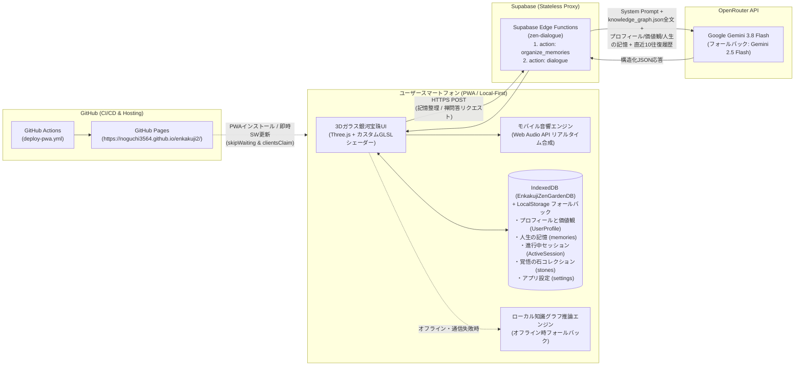

# 円覚寺禅問答・心庭（ガラス銀河宝珠）・瞑想PWAアプリ 完全設計仕様書

**Version:** 3.2（プロフィール・価値観の独立・フラットカード選択＆動的揺らぎ対話統合版）  
**最終更新日:** 2026年11月13日  
**開発対象:** スマートフォン特化型 プログレッシブWebアプリ（PWA）  
**公開URL:** https://noguchi3564.github.io/enkakuji2/  
**基本思想:** 問い、沈黙、観察、手放し、そして「覚悟の石（一等星）」の顕現（フロー理論と円覚寺全脳知識ネットワークの融合）

---

## 第1章 アプリの目的とコア体験（UX洞察）

### 1.1 コンセプト
本アプリは、臨済宗大本山円覚寺の法脈（朝比奈宗源老師、横田南嶺老師、盤珪永琢禅師の不生禅）を体系化した**「全脳知識ネットワーク（`knowledge_graph.json`）」**を知識基盤とし、AIとの禅問答・自然環境音による身体技法（瞑想）・幻想的な光と宇宙が息づく3D「心庭（ガラス銀河宝珠）」を融合させた自己省察・フロー体験アプリである。

通常のAIチャットのように即席の正解を与えるのではなく、ユーザー自身の「プロフィール・価値観・人生の記憶」に寄り添いながら**5〜10往復の問答を通じて内なる気づきを促し、最終的にユーザーが自らの肚（はら）を据えて導き出した結論を「覚悟の石（一等星）」としてガラス宝珠の宇宙に結晶化・発光させる**ことで、深い自己変容と没入（フロー）をもたらす。

### 1.2 チクセントミハイ「フロー理論」に基づく没入設計
`deep-research-report.md` で考察されたフロー理論および神経科学的知見（デフォルトモードネットワーク［DMN：反芻思考や過度な自意識］の抑制と、内発的報酬系の活性化）を、禅の体験プロセスに以下のように統合している。

1. **課題と能力の動的バランス（Dynamic Difficulty Adjustment: 揺らぎと収束の対話モデル）**
   - 苦悩の渦中にあるユーザー（高ストレス状態）にいきなり厳しい公案を突きつけると「不安（Anxiety）」に陥り、逆に表層的な慰めやオウム返しの傾聴だけでは「退屈（Boredom）」や「思考の堂々巡り」を生む。
   - そのため、本アプリのAI問答は単純な直線的フェーズ進行ではなく、**「コーチングの基盤」と「禅による揺らぎ」を行き来しながら、ユーザーの機加減を見極めて「主体的覚悟」へ導く動的対話モデル**を採用する。
     - **Base Phase（傾聴と自己探索のコーチング）：** 対話の大部分（約7〜8割）を占める基盤モード。禅の難解な用語や仏教思想は前面に出さず、プロのコーチ・カウンセラーとして純粋な傾聴、受容、深掘りの問い（Why/What）に徹する。事前に設定された「ユーザーの立場や2つの価値観」を裏のコンパスとし、的を射た問いかけを行う。
     - **Zen Shift（禅脳へのパラダイムシフト・揺らぎ）：** Base Phase が数回（2〜3往復）続いた後、あるいはユーザーの思考が堂々巡りしているとAIが判定したタイミングで発動。`knowledge_graph.json` に定義された智慧（不生の仏心、丸木橋の手放し等）を身近な比喩として投下し、これまでの思考の枠組みを外す問いを投げる。揺らぎの提示後は再び Base Phase でユーザーの受け止めを深掘りする。
     - **Phase 3（主体的覚悟への収束）：** 揺らぎの往復の中で、ユーザーの発言に「自己解決の兆し」「執着からの脱却」「自分の足で立つ言葉」が検知された場合、深掘りを停止し、肚を据えて自らの結論を出すためのクロージングフェーズへ移行する。
2. **認知負荷の極小化と幻想的な「心庭」への完全没入**
   - 画面中央には文字やバナーを一切重ねず、紫・蒼・紅・黄金が溶け合う「ガラス銀河宝珠」と、その下部でぼわーっと光りピカピカと煌めきが立ち昇るアンダーグロウ演出のみを配置。
   - 各モーダル（「プロフィールと価値観」「人生の記憶」「禅問答開始」など）も細かい説明文を排し、大きめの文字サイズと直感的な操作体系に統一することで、脳の分析的な過剰防衛（DMN）を鎮め、「今ここ」の対話に集中させる。
3. **即時フィードバックと「覚悟の石（星）」による内発的報酬（Autotelic Experience）**
   - ユーザーの1回ごとの発言や画面操作に呼応して、432Hz基準の柔らかな「おりん（水滴音）」が響き、3Dガラス球内部に光の波紋（Ripple Pulse）が広がる。
   - 問答の果てにユーザー自身が「自分の結論（覚悟・気づき）」を見出した瞬間、288Hz/576Hz/864Hzの深い「磬子（けいす）」の倍音とともに**「覚悟の石」**が立ち上がり、ガラス宝珠の中の宇宙に一等星として永続配置される。

---

## 第2章 システムアーキテクチャと配布・データ保存仕様

### 2.1 全体アーキテクチャ図



### 2.2 PWA配布・即時更新・インストール仕様
* **ビルド・配信基盤:** `.github/workflows/deploy-pwa.yml` により、`main` ブランチへのプッシュ時に自動で TypeScript 型検査・Vite 本番ビルドを実行し、**GitHub Pages**（`https://noguchi3564.github.io/enkakuji2/`）へデプロイする。
* **スマートフォンへのインストール:** `vite-plugin-pwa` により Web App Manifest（`manifest.webmanifest`）を生成。`192x192` および `512x512` の専用PNGアイコン（`any` / `maskable` 両対応）を備え、Android Chrome / iOS Safari の「ホーム画面に追加」からブラウザバッジなしのネイティブアプリ同等フルスクリーン（`display: standalone`, `orientation: portrait`）で起動する。
* **Service Worker 即時更新:** `workbox` 設定にて `skipWaiting: true`、`clientsClaim: true`、`cleanupOutdatedCaches: true` を有効化しており、新しいビルドがデプロイされると即座に最新アセットへ切り替わる。

### 2.3 完全ローカルデータ保存（プライバシー・バイ・デザイン）
* **サーバー側DB不使用（Stateless Backend）:** ユーザーの詳細なプロフィール、2つの価値観、人生の記憶（喜怒哀楽エピソード）、悩み、対話履歴、獲得した「覚悟の石」、アプリ設定は、**すべてユーザーのスマートフォン内部（IndexedDB `EnkakujiZenGardenDB` および `localStorage`）にのみ保存される。**
* **視覚的な安心感の提示:**
  - ホーム画面ヘッダー左上に「端末内保存」バッジを常設。
  - アプリ起動時および「端末内保存」バッジのタップ時に、画面上部へ「記録はクラウドに残らず、このスマホ内だけに保存されます」という安心トーストをふわっと表示し、数秒後に自動でフェードアウトさせる。

### 2.4 LLM推論基盤でのプロフィール・価値観の活用
フロントエンドからは Supabase Edge Function（`zen-dialogue`）のみを呼び出し、OpenRouter 経由で `google/gemini-3.8-flash`（フォールバック: `gemini-2.5-flash`）を実行する。
AIはシステムプロンプトに注入されたユーザーのプロフィールと「2つの価値観」を深く理解し、対話を動的に最適化する。
* **コーチング基盤（Base Phase）：** 例えば「経営者」であり「責任を果たす」を選んだユーザーには、その責任の重圧に真摯に寄り添う言葉遣いで傾聴し、状況の整理を促す。
* **禅モード（Zen Shift）：** 例えば「家族とともに」「心穏やかに」を重視するユーザーが仕事の責任で燃え尽きそうになっている場合、「家族や心穏やかな時間を大切にするあなたにとって、今握りしめているその力みを手放すとしたら？」など、価値観をテコにしたパラダイムシフトの問いを投げる。

---

## 第3章 全脳知識ネットワーク（`knowledge_graph.json`）の構造

`knowledge_graph.json` には以下の5大要素が定義されており、Edge Function とフロントエンドの双方から完全参照される。

1. **`masters`（3名の禅師・管長）:**
   - `M_Asahina`（朝比奈宗源：仏心の信心、苦中の真楽、肚を据える覚悟、道は吾である）
   - `M_Yokota`（横田南嶺：不生の受容、共苦［コンパッション］の慈悲、身体呼吸への委ね、花のように生きる）
   - `M_Bankei`（盤珪永琢：不生の仏心で一切の事は調う）
2. **`sufferings`（6つの苦悩類型と3段階の転換パス `transforms_to_ids`）:**
   - `Suf_Anxiety`（焦燥・自己無価値感）
   - `Suf_Grief`（死別・喪失の悲嘆）
   - `Suf_FearOfFailure`（重責・失敗の恐怖）
   - `Suf_Isolation`（孤立感・承認渇愛）
   - `Suf_Decline`（心身の衰え・老病の苦）
   - `Suf_PerfectionismBurnout`（完璧主義・燃え尽き）
3. **`wisdoms`（7つの智慧の境地と属性 `orientation`）:**
   - `Wis_UnbornMind`（不生の仏心 / `accepting`）
   - `Wis_LettingGoBridge`（丸木橋の手放し / `accepting`）
   - `Wis_FlowerLife`（花のように生きる / `accepting`）
   - `Wis_OceanAndDrop`（大海と一滴の生命 / `transcendent`）
   - `Wis_OrdinaryMindSamu`（平常心是道・作務の禅 / `transcendent`）
   - `Wis_RealJoyInPain`（苦中の真楽・道は吾である / `resolute`）
   - `Wis_GreatCompassion`（共苦の慈悲・入鄽垂手 / `solidarity`）
4. **`discourses`（10編の法話・語録・出典タイトル・円覚寺公式URL）:**
   - 丸木橋と蒲団の譬え、老農婦の問い、大海の泡、落ち葉掃きの作務、朝比奈老師の獅子吼など。
5. **`praxes`（7つの身体技法・呼吸法・作務）:**
   - `Pra_TandenBreathing`（立腰・丹田呼気充実）、`Pra_SurrenderBreath`（無意識呼吸への帰依）、`Pra_SweepingSamu`（掃き清めの作務）、`Pra_GasshoRecitation`（合掌・感謝の言霊）、`Pra_ChairZazen`（イス坐禅・足の裏の接地）、`Pra_MorningInvocation`（朝の立腰念誦法）、`Pra_OpenHandSurrender`（丸木橋の手放し・脱力と蒲団の瞑想）。

---

## 第4章 3Dビジュアル＆UIデザイン仕様：「ガラス銀河宝珠」と「アンダーグロウ光彩」

### 4.1 3Dレンダラー構成（`ZenGardenCanvas.tsx`）
Three.js（WebGLRenderer / ACESFilmicToneMapping）とカスタムGLSLシェーダーを用い、画面中央に思わず見惚れる幻想的な色気と奥行きを持つ**「クリスタルガラス銀河宝珠（ORB_RADIUS = 1.0）」**を描画する。

1. **4色スパイラル銀河シェーダー（4,800恒星粒子）とボリューメトリック星雲ヴェール:**
   - X軸 `0.50 rad`・Z軸 `-0.23 rad` に傾けた銀河面上に、2本の主渦状腕と2本の副腕からなる対数らせん銀河を配置し、ケプラー差動回転（$\omega = \frac{0.22}{r + 0.18}$）によって中心ほど速く、外縁ほどゆったりと回転させる。
   - **色彩設計:** 加算合成による中心の白飛びを抑え、渦状腕の間の暗い宇宙の奥行き（ダストレーン）を残しながら以下の4色が絹のように溶け合う：
     - **中心核（$r < 0.18$）:** シャンパンゴールド ＆ ローズアンバー
     - **中間スパイラル（$0.18 \le r < 0.56$）:** ルミナス・サファイアシアン（蒼）、アメジスト・バイオレット（紫）、クリムゾン・ローズ（紅）、金砂子
     - **外縁スパイラル（$r \ge 0.56$）:** ディープアメジスト、コバルトブルー、ルビーローズ
   - さらに渦状腕に沿って、紫・サファイア青・クリムゾン紅の17枚のソフト星雲スプライト（`nebulaGroup`）が重なり、深みのある星雲ガスを表現する。

2. **ガラス球の下部「アンダーグロウ（光の溜まり）」＆「立ち昇る180個の煌めき粒子」:**
   - **多層オーラ池＆コースティクス波紋シェーダー:** ガラス球の底面直下（$y = -1.06 \sim -1.14$）に、バイオレット〜サファイア青とローズ〜琥珀金のオーラスプライト、および水平面で緩やかに脈動するコースティクス（集光リング波紋）シェーダーディスクを配置。呼吸周期に合わせてぼわーっと柔らかく伸縮する。
   - **180個の立ち昇るダイヤモンド光粒子（`underSparkles`）:** 球体の下部輪郭を包み込むように、シャンパンゴールド・ローズピンク・サファイアシアン・アメジスト紫の粒子がゆっくりと螺旋を描いて立ち昇る。フラグメントシェーダーで十字の光芒（クロスレイ）を描画し、ピカピカと繊細に瞬かせる。

3. **多層プリズム色収差クリスタルガラス球シェーダー:**
   - 球体内部の銀河や星を曇らせないよう、輪郭（フレネル反射 $\text{pow}(1 - |N \cdot V|, 3.4)$）にシャープな光を集め、上部はサファイアシアン、側面はアメジストバイオレット、底面はローズアンバーへと滑らかに移ろう。
   - 底面にはアンダーグロウからの照り返し（`bottomBounce`）が入り、左上リムと右下リムには三日月状のシャープな鏡面ハイライトが入ることで、本物の硝子玉のような濡れた艶を生み出す。
   - ユーザーはドラッグ（スワイプ）で360度自由に宝珠を回転でき、ピンチ操作でズームイン／アウトが可能。

4. **「覚悟の石（一等星）」の立体配置と回折スパイク:**
   - 獲得した「覚悟の石」は、ガラス球内部の8つのオクタント×内外2層（計16セクター）にバランスよく3D配置される。
   - 各星は `512×512` の高精細 `CanvasTexture` により、4つのカラーテーマ（`golden_resolve`: 黄金アンバー、`sapphire_zen`: サファイアブルー、`emerald_glow`: エメラルドグリーン、`lotus_warm`: 紅蓮ロータスピンク）の色彩ブルームと、縦・横・斜め45度の鋭い8方向回折スパイクを放つ。
   - Raycaster により、3D空間内の星を直接タップすると「おりん」の音が響き、その石の詳細ドロワー（`StoneDetailDrawer`）が開く。

### 4.2 ホーム画面（`GARDEN_HOME`）の3ゾーン・ミニマルレイアウト
- **上部ヘッダー:**
  - 左側: 「心 庭」タイトルと「端末内保存」バッジ。
  - 右側: **「プロフィールと価値観」（新設・未設定時はやさしく促すバッジ表示）**、「記憶（喜怒哀楽の登録件数）」、「覚悟の石（所持数）」、「PWAインストール」、「設定」の各アイコンボタンを配置。
- **中央ステージ:** 完全な余白（`pointer-events-none`）とし、3Dガラス銀河宝珠とアンダーグロウ、内部の覚悟の星を100%遮らずに表示。
- **下部ドック:**
  - 所持している「覚悟の石」の極薄ガラスピル・カルーセル（タップで詳細表示）。
  - 途中の禅問答セッションがある場合の「途中の対話を再開」ボタン。
  - メインアクション「禅問答を始める」ボタンと、ワンタップで自然音瞑想へ入る「風（自然音瞑想）」アイコンボタン。

---

## 第5章 画面遷移と機能詳細（全5モード＋4モーダル）

```mermaid
stateDiagram-v2
    [*] --> GARDEN_HOME: アプリ起動（3Dガラス銀河宝珠表示）
    
    GARDEN_HOME --> USER_PROFILE_MODAL: 「プロフィール」ボタンタップ\n(背景・責任・転機・18枚の価値観から2枚選択)
    USER_PROFILE_MODAL --> GARDEN_HOME: 保存して閉じる

    GARDEN_HOME --> LIFE_MEMORIES_MODAL: 「記憶」ボタンタップ\n(喜・怒・哀・楽エピソードのAI自動整理)
    LIFE_MEMORIES_MODAL --> GARDEN_HOME: 保存して閉じる
    
    GARDEN_HOME --> INITIAL_ASSESSMENT: 「禅問答を始める」タップ
    INITIAL_ASSESSMENT --> INQUIRY: 今の気になっていること（任意）を入力して「対話を始める」タップ
    
    state "INQUIRY：AI禅問答（コーチング基盤 ⇔ 禅の揺らぎ ⇔ 覚悟への収束）" as INQUIRY {
        BasePhase: Base Phase：傾聴と自己探索\n(コーチング基盤・価値観コンパスによる深掘り)
        ZenShift: Zen Shift：禅脳へのパラダイムシフト\n(智慧の比喩投下・思考の枠組みを外す揺らぎ)
        Phase3: Phase 3：主体的覚悟への収束\n(気づきの萌芽検知・肚を据えるクロージング)
        BasePhase --> ZenShift: 2〜3往復後 または 思考の堂々巡り
        ZenShift --> BasePhase: 視点の揺らぎを経た深掘り再開
        BasePhase --> Phase3: 自己解決の兆し・執着脱落の検知
    }

    INQUIRY --> PRAXIS_MEDITATION: AIからの身体技法提案 (praxis_offer)\nまたは「自然音で呼吸を整える」タップ
    GARDEN_HOME --> PRAXIS_MEDITATION: ホーム下部「自然音瞑想」アイコンタップ
    PRAXIS_MEDITATION --> INQUIRY: 瞑想完了（進行中セッションがある場合）
    PRAXIS_MEDITATION --> GARDEN_HOME: 瞑想完了（ホームから直接開始した場合）

    INQUIRY --> STONE_MANIFESTATION: ユーザーが結論に到達 (resolution_stone)\nまたは「今の結論を『覚悟の石』に結ぶ」タップ
    STONE_MANIFESTATION --> GARDEN_HOME: 「心の庭にこの『覚悟の石』を据える」タップ
    
    GARDEN_HOME --> STONE_DETAIL_DRAWER: 3D球体内の星 または 下部ピルをタップ
    STONE_DETAIL_DRAWER --> GARDEN_HOME: 閉じる / 石を手放す
```



### 5.1 「プロフィールと価値観」設定モーダル（`UserProfileModal.tsx`）[NEW]
AIが最適な問いかけを作るためのコンテキスト入力画面。「書きたくないことは空欄のままで構いません」と明記し、心理的安全性を担保する。

1. **セクション1: 背景・経験（すべて任意）**
   - **生年月日・性別・立場:** 生年月日は日付入力（`input type="date"`）により入力。時間の経過に伴って現在の満年齢が自動計算され、AI対話時にも常に正確な年齢として参照される。性別・立場はプルダウン（未設定可）。
   - **抱えている責任や向き合っていること:** 数行の自由記述（プレースホルダーに気軽な例を提示）。
   - **心に残る経験や転機:** 数行の自由記述。
2. **セクション2: 価値観カード（フラットな18枚から直感で2枚選択）**
   - カテゴリ分類（社会・個性・生活など）は一切表示せず、以下の全18種類のカードをフラットなグリッドで並べる：
     `社会に貢献` `誰かのために` `社会を変えたい` `気になるテーマで` `地域のために` `何かを生み出す` `自分らしく` `夢中になれる` `経験と能力を活かす` `自分の裁量で` `責任を果たす` `仲間とともに` `家族とともに` `仕事も生活も` `好きな場所で` `自分の時間` `心穏やかに` `地球にやさしく`
   - **操作の制約とUI:** 「最も大切にしている価値観を直感で【2つ】選んでください」と案内。2枚選択した瞬間に残り16枚がグレーアウト（透過度低下）し、上限に達したことを視覚的にフィードバックする。タップでいつでも選択解除・変更が可能。

### 5.2 「人生の記憶（人生に影響を与えた記憶）」モーダル（`LifeMemoriesModal.tsx`）
* **人生に影響を与えた記憶の記録に特化:** 生年月日・性別・立場などの基本プロフィール入力は「プロフィールと価値観」モーダルへ一元化し、本モーダルからは重複を完全に撤廃。
* **自由記述・音声入力からのAI自動整理:** 「何歳頃、どういうことがあったか」（例：「24歳の時に初めての仕事で大失敗したが、先輩に支えられて乗り越えた」「32歳で独立」「40歳の時に家族との別れ」など）を自由に書いて「記憶を記録する（AIで自動整理）」を押すと、AIが自動で「時期（何歳頃・時代）」「内容」「喜・怒・哀・楽」のエピソードカードに分解し、端末内に保存する。
* **感情カテゴリ別フィルタリング:** 「全て」「喜」「怒」「哀」「楽」の5つのタブで、人生に影響を与えた記憶カードを絞り込み閲覧・個別削除できる。

### 5.3 禅問答開始モーダル（`AssessmentModal.tsx`）
* **重複ボタンの撤廃と対話開始への集中:** プロフィール・価値観および人生の記憶の入力はホーム画面の独立ボタンへ移行したため、本モーダルからは重複する入力・編集ボタンを完全撤廃。すでに登録されている価値観や記憶がある場合は、タイトル下に控えめなピルバッジ（「価値観: 〇〇」「記憶: 〇件」）で反映状況を提示。
* **テーマ入力とワンタップ開始:** 「今、気になっていることはありますか？（任意）」に自由記述（空欄でも可）を入力して「対話を始める」を押すだけで、直ちに第1問目の禅問答が開始される。

### 5.4 AI禅問答オーバーレイ（`InquiryOverlay.tsx`）
* **動的対話制御（Base Phase ⇔ Zen Shift ⇔ Phase 3）：**
  - **Base Phase:** ユーザーの立場や2つの価値観をベースに、プロのコーチとして共感と受容を示しながら深掘りを行う。
  - **Zen Shift:** 思考の堂々巡りや膠着を検知した際、下部のアンダーグロウがわずかにサファイアブルーへ変化し、禅の智慧（丸木橋、不生、平常心など）の比喩を投げかけて視点を揺さぶる。
  - **Phase 3への収束:** ユーザー自身の言葉に覚悟の芽や気づきが見えた段階でAI自ら深掘りを停止し、「今のあなたの言葉を肚に据えるなら、どんな覚悟になりますか」と結論を促す。
* **ユーザー主体の自由度:** 途中でいつでも「自然音で呼吸を整える」ボタンで瞑想に入ることができ、1往復目以降ならいつでも「今の結論を『覚悟の石』に結ぶ」ボタンで手動結晶化が可能。

### 5.5 身体技法＆自然環境音瞑想オーバーレイ（`MeditationOverlay.tsx`）
* **環境音セレクター:** 「雨」「波」「森」「小川」「静寂」の5種類をリアルタイム切り替え。
* **タイマーセレクター:** 3分・5分・10分の切り替えと、呼吸に合わせて脈動する二重の円相リング＆カウントダウン表示。残り0秒になると「磬子（けいす）」の倍音が鳴り響く。
* **円覚寺 身体技法（Praxis）カード:** `knowledge_graph.json` の7つの身体技法をプルダウンで切り替えられ、具体的な実践方法と目指す境地を表示。

### 5.6 「覚悟の石」顕現モーダル ＆ 詳細ドロワー
* **顕現アニメーション:** 900msの光の収束から、後光リングと回転する円相の中で多面体クリスタルSVGが浮かび上がるリッチな演出。
* **授与される情報:** 石の銘、到達した智慧、ユーザー自身の結論要約、および円覚寺師家の法話（quote 原文・出典タイトル・公式URL）。
* **詳細振り返りドロワー:** ホーム画面で石（星）をタップすると、生成日時、参照された人生の記憶件数、自分の結論、師家の法話、および「この石を生んだ禅問答の記録（最大20発言の折りたたみ履歴）」をいつでも振り返ることができ、不要になった石は手放す（削除）ことができる。

### 5.7 設定＆全脳知識ネットワーク閲覧モーダル（`SettingsAndGraphModal.tsx`）
* 自然環境音・おりんの音量スライダー、瞑想基本時間設定、端末内データ初期化ボタン。
* `knowledge_graph.json` の「師家・法脈」「智慧の境地」「苦悩類型と3段階転換パス」を一覧閲覧できるリファレンスビューア。

---

## 第6章 モバイル音響合成エンジン仕様（`soundEngine.ts`）

Web Audio API を用いてリアルタイムに音響を生成する。外部MP3ファイルに依存しない完全自己完結型。

1. **iOS Safari 消音スイッチ（マナーモード）対策:**
   - `navigator.audioSession.type = "playback"` を設定。
   - 初回タップ時に極小の無音WAVデータURI（`SILENT_UNLOCK_WAV`）を `HTMLAudioElement` で再生し、WebKit のメディア音声チャンネルを確実にアンロックする。
2. **スマートフォン向け実効音圧（RMS）正規化と中域ブースト:**
   - 8秒間のステレオ・ピンクノイズ／ブラウンノイズバッファを生成してピーク正規化し、スマホのスピーカーで最も聞き取りやすい **250Hz〜1800Hz の中音域** をバイクアッドフィルタで豊かに設計。
   - 雨（雨だれパルス付き）、波（9秒周期のうねりLFO）、森（風の揺らぎと倍音チャイム）、小川（せせらぎと水琴窟ペンタトニック倍音：528Hz, 660Hz, 792Hz, 880Hz, 1056Hz）。
3. **UI効果音とクライマックス倍音:**
   - **おりん・水滴音（`playWaterDrop`）:** 432Hz基準のサイン波（0.85秒減衰）。
   - **磬子・シンギングボウル音（`playStoneManifestationBell`）:** 288Hz（5.0秒減衰）、576Hz（4.2秒減衰）、864Hz（3.4秒減衰）の3倍音合成。

---

## 第7章 データスキーマとディレクトリ構成

### 7.1 端末内ストレージ（IndexedDB `EnkakujiZenGardenDB`）のデータ構造

```typescript
// 1. プロフィールと価値観（拡張）
export interface UserLifeProfile {
  birthDate?: string;               // 年代・生年月日（任意）
  gender?: string;                  // 性別（任意）
  lifeContext?: string;             // 現在の立場・役割（任意）
  currentResponsibilities?: string; // 抱えている責任や向き合っていること（任意自由記述）
  pastExperiences?: string;         // 心に残る経験や転機（任意自由記述）
  coreValues: string[];             // 選択された2つの価値観（18種から選択、例: ["経験と能力を活かす", "心穏やかに"]）
  memories: LifeMemoryItem[];       // AI整理済みの喜怒哀楽エピソード群
  updatedAt: string;
}

export interface LifeMemoryItem {
  id: string;
  emotion: "ki" | "do" | "ai" | "raku"; // 喜・怒・哀・楽
  period?: string;                      // 時期（例：「20代の頃」「3年前」）
  content: string;                      // エピソード内容
  createdAt: string;
}

// 2. 獲得した「覚悟の石（一等星）」データ
export interface SavedResolutionStone {
  id: string;
  createdAt: string;
  stone_title: string;
  user_conclusion: string;
  initial_concern: string;
  assessment: {
    initialConcern?: string;
    lifeProfileSnapshot?: UserLifeProfile;
  };
  wisdom_id: string;
  wisdom_name: string;
  discourse_id: string;
  quote: string;
  master_name: string;
  source_title: string;
  source_url: string;
  visual: {
    color_theme: "emerald_glow" | "sapphire_zen" | "golden_resolve" | "lotus_warm";
    shape_type: "round_pebble" | "standing_monolith" | "crystal_zen" | "moss_jewel";
    glow_intensity: number;
    position: { x: number; y: number };
  };
  dialogue_digest: Array<{ role: "user" | "assistant"; content: string }>;
}

// 3. アプリ設定
export interface AppSettings {
  soundVolume: number;
  defaultMeditationMinutes: 3 | 5 | 10;
  hapticFeedback: boolean;
}
```

### 7.2 プロジェクトディレクトリ構成

```text
enkakuji2/
├── .github/workflows/
│   └── deploy-pwa.yml               # GitHub Pages 自動ビルド・デプロイCI/CD
├── public/
│   ├── favicon.svg                  # ベクターアイコン
│   ├── apple-touch-icon.png         # iOS ホーム画面用アイコン
│   ├── pwa-192x192.png              # PWA Manifest 用 192x192 PNG
│   └── pwa-512x512.png              # PWA Manifest 用 512x512 PNG (any & maskable)
├── src/
│   ├── components/
│   │   ├── ZenGardenCanvas.tsx      # Three.js 3Dガラス銀河宝珠＆アンダーグロウ光彩シェーダー
│   │   ├── UserProfileModal.tsx     # [NEW] プロフィール入力と18枚の価値観カード選択モーダル
│   │   ├── LifeMemoriesModal.tsx    # 「人生の記憶（喜怒哀楽）」AI自動整理・管理モーダル
│   │   ├── AssessmentModal.tsx      # 禅問答開始モーダル
│   │   ├── InquiryOverlay.tsx       # 動的揺らぎ対応AI禅問答オーバーレイ
│   │   ├── MeditationOverlay.tsx    # 身体技法（Praxis）＆自然環境音瞑想モード
│   │   ├── StoneManifestationModal.tsx # 「覚悟の石」顕現クライマックス画面
│   │   ├── StoneDetailDrawer.tsx    # 「覚悟の石」詳細・対話履歴振り返りドロワー
│   │   └── SettingsAndGraphModal.tsx # 音響設定・データ初期化・全脳知識ネットワーク閲覧
│   ├── services/
│   │   ├── zenAiService.ts          # Edge Function 通信＆ローカル知識グラフ推論フォールバック
│   │   ├── localDb.ts               # IndexedDB / LocalStorage 端末内永続化サービス
│   │   └── soundEngine.ts           # Web Audio API 自然音・おりん・磬子リアルタイム合成
│   ├── store/
│   │   └── useZenStore.ts           # Zustand グローバル状態管理ストア
│   ├── types/
│   │   └── zen.ts                   # アプリ全体の TypeScript 型定義
│   ├── App.tsx                      # メインコンテナ（3ゾーン構成ホーム＆モーダル制御）
│   ├── main.tsx                     # エントリーポイント＆Service Worker 登録
│   └── index.css                    # Tailwind CSS ＆ カスタムアニメーション定義
├── supabase/functions/zen-dialogue/
│   ├── index.ts                     # OpenRouter (Gemini 3.8 Flash) 中継 Edge Function
│   └── knowledge_graph.json         # Edge 側バンドル用 全脳知識ネットワーク
├── knowledge_graph.json             # フロントエンド側参照用 全脳知識ネットワークマスタ
├── spec.md                          # 本設計仕様書（Version 3.2）
├── vite.config.ts                   # Vite & vite-plugin-pwa 設定
└── package.json                     # 依存パッケージ定義
```

---

## 第8章 受け入れ基準と検証仕様（Acceptance Criteria）

| 検証項目 | 期待される動作・受け入れ基準 | 検証方法・実装コンポーネント |
| :--- | :--- | :--- |
| **プロフィール入力の任意性** | `UserProfileModal` にて、「スキップ可能・空欄可」であることが明記され、未入力のままでも保存・スキップしてアプリを利用できること。 | `UserProfileModal.tsx` |
| **価値観カードのフラット選択** | 18枚のカードがカテゴリ分けなしで一覧表示され、ちょうど2枚選択した時点で他の16枚がグレーアウトし選択不可になること。タップで選択解除・再選択できること。 | `UserProfileModal.tsx` |
| **AIへのコンテキスト注入** | 設定したプロフィール内容と2つの価値観がシステムプロンプトに反映され、AIの問い（コーチング／禅モード共）がその属性や価値観を配慮した内容に変化すること。 | `zenAiService.ts` / `zen-dialogue` |
| **動的揺らぎと収束の対話** | 単純な固定回数遷移ではなく、Base Phase と Zen Shift を行き来し、自己解決の兆し検知によって Phase 3（覚悟の石生成）へ誘導されること。 | `InquiryOverlay.tsx` / `zen-dialogue` |
| **3Dガラス銀河宝珠レンダリング** | 画面中央に紫・蒼・紅・黄金が溶け合う4色スパイラル銀河とボリューメトリック星雲、底面アンダーグロウ（光の溜まり）、および180個の立ち昇る光粒子が白飛びせず滑らかに描画されること。スワイプで360度回転できること。 | `ZenGardenCanvas.tsx` / Three.js カスタムGLSLシェーダー |
| **人生の記憶・AI自動整理** | 音声入力や自由記述で語られたテキストが、Edge Function 経由で「喜・怒・哀・楽」の個別エピソードカードに自動分類・構造化されて端末内に保存されること。 | `LifeMemoriesModal.tsx` / `zen-dialogue` (`action: "organize_memories"`) |
| **身体技法提案と自然音瞑想** | 雨・波・森・小川・静寂の自然音（250〜1800Hz中域強調・音圧正規化済み）と身体技法ガイド付きでタイマー瞑想ができること。iOSマナーモードでも再生されること。 | `MeditationOverlay.tsx` / `soundEngine.ts` |
| **「覚悟の石」顕現と永続保存** | 結論到達時に石の顕現アニメーションとともにユーザー結論と師家の法話（出典URL付き）が授与され、ガラス宝珠内に回折スパイクを持つ一等星として永続配置されること。タップで詳細が開くこと。 | `StoneManifestationModal.tsx` / `StoneDetailDrawer.tsx` |
| **完全ローカル保存（プライバシー）** | プロフィール・価値観・会話ログ・人生の記憶・石がすべて端末内の IndexedDB (`EnkakujiZenGardenDB`) / LocalStorage にのみ保存され、外部DBへの個人データ送信が一切行われないこと。 | `localDb.ts` / `useZenStore.ts` |
| **オフライン・耐障害性** | 通信障害や機内モード時でも、フロントエンド内蔵の `knowledgeGraph` によるローカル推論エンジンが自動で作動し、記憶整理・問答・石生成が途切れず完了すること。 | `zenAiService.ts` (`generateLocalKnowledgeGraphResponse`) |
| **PWAスタンドアロン起動** | ホーム画面追加時にブラウザ枠のない全画面（`display: standalone`）で起動し、ブラウザバッジなしで専用PNGアイコンが表示されること。 | `vite.config.ts` / `manifest.webmanifest` |

---

## 第9章 環境構築・デプロイ・運用手順

### 9.1 環境変数とSecrets設定

1. **GitHub リポジトリ（GitHub Actions デプロイ用）:**
   - リポジトリの `Settings` -> `Secrets and variables` -> `Actions` に以下を設定：
     - `VITE_SUPABASE_EDGE_URL`: `https://<project-ref>.supabase.co/functions/v1/zen-dialogue`
     - `VITE_SUPABASE_ANON_KEY`: Supabase の `anon public` キー
2. **Supabase Edge Functions（LLM中継用）:**
   - Supabase ダッシュボードまたは CLI より以下を設定：
     - `OPENROUTER_API_KEY`: OpenRouter の API キー（必須）
     - `OPENROUTER_MODEL`: 使用モデルID（デフォルト: `google/gemini-3.8-flash`、フォールバック: `google/gemini-2.5-flash`）

### 9.2 ローカル開発とビルド

```bash
# 依存パッケージインストール
npm install

# 開発サーバー起動（ローカルポート 5173）
npm run dev

# 本番ビルド（TypeScript 型検査 + Vite ビルド + PWA アセット生成）
npm run build

# ビルド成果物のローカルプレビュー
npm run preview
```

### 9.3 本番デプロイとPWAキャッシュ更新手順

1. **GitHub Pages への自動デプロイ:**
   - ローカルの変更を `main` ブランチにコミットしてプッシュすると、`.github/workflows/deploy-pwa.yml` が自動起動し、約1〜2分で本番環境（`https://noguchi3564.github.io/enkakuji2/`）へ反映される。
2. **クライアント側のPWA更新挙動:**
   - Service Worker の `skipWaiting` および `clientsClaim` により、次回アクセス時またはバックグラウンド通信完了時に即座に新しいアセットへ自動更新される。手動で強制更新したい場合はブラウザのリロードを実行する。
