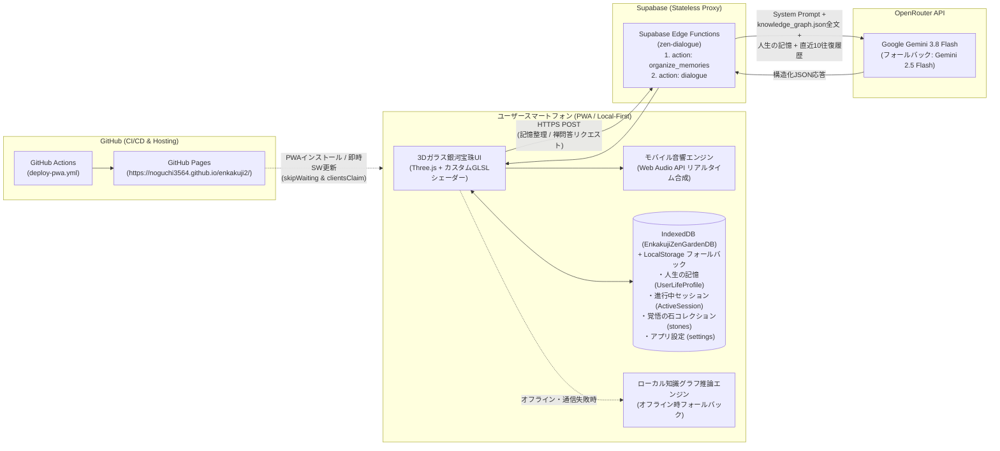
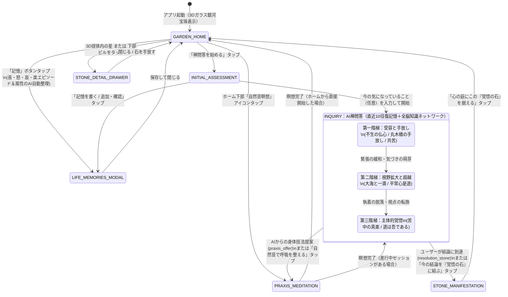

# 円覚寺禅問答・心庭（ガラス銀河宝珠）・瞑想PWAアプリ 完全設計仕様書

**Version:** 3.0（実装完全同期版）  
**最終更新日:** 2026年11月12日  
**開発対象:** スマートフォン特化型 プログレッシブWebアプリ（PWA）  
**公開URL:** https://noguchi3564.github.io/enkakuji2/  
**基本思想:** 問い、沈黙、観察、手放し、そして「覚悟の石（一等星）」の顕現（フロー理論と円覚寺全脳知識ネットワークの融合）

---

## 第1章 アプリの目的とコア体験（UX洞察）

### 1.1 コンセプト
本アプリは、臨済宗大本山円覚寺の法脈（朝比奈宗源老師、横田南嶺老師、盤珪永琢禅師の不生禅）を体系化した**「全脳知識ネットワーク（`knowledge_graph.json`）」**を知識基盤とし、AIとの禅問答・自然環境音による身体技法（瞑想）・幻想的な光と宇宙が息づく3D「心庭（ガラス銀河宝珠）」を融合させた自己省察・フロー体験アプリである。

通常のAIチャットのように即席の正解を与えるのではなく、ユーザー自身の「人生の記憶（喜・怒・哀・楽の経験）」に寄り添いながら**5〜10往復の問答を通じて内なる気づきを促し、最終的にユーザーが自らの肚（はら）を据えて導き出した結論を「覚悟の石（一等星）」としてガラス宝珠の宇宙に結晶化・発光させる**ことで、深い自己変容と没入（フロー）をもたらす。

### 1.2 チクセントミハイ「フロー理論」に基づく没入設計
`deep-research-report.md` で考察されたフロー理論および神経科学的知見（デフォルトモードネットワーク［DMN：反芻思考や過度な自意識］の抑制と、内発的報酬系の活性化）を、禅の体験プロセスに以下のように統合している。

1. **課題と能力の動的バランス（Dynamic Difficulty Adjustment: 問答の3フェーズ遷移）**
   - 苦悩の渦中にあるユーザー（高ストレス・扁桃体過活動状態）にいきなり厳しい公案を突きつけると「不安（Anxiety）」に陥り、逆に表層的な慰めだけでは「退屈（Boredom）」を生む。
   - そのため、`knowledge_graph.json` の `transforms_to_ids` に定義された **Phase 1（受容・手放し：1〜3往復目目安）→ Phase 2（視野拡大・超越：4〜6往復目目安）→ Phase 3（主体的覚悟・苦中の真楽：6〜10往復目目安）** の3段階に沿って、ユーザーの「人生の記憶」や直近の回答の深まりに応じた問いの強度調整（DDA）を行う。
2. **認知負荷の極小化と幻想的な「心庭」への完全没入**
   - 画面中央には文字やバナーを一切重ねず、紫・蒼・紅・黄金が溶け合う「ガラス銀河宝珠」と、その下部でぼわーっと光りピカピカと煌めきが立ち昇るアンダーグロウ演出のみを配置。
   - 各モーダル（「人生の記憶」「禅問答開始」など）も細かい説明文を排し、大きめの文字サイズと直感的な操作体系に統一することで、脳の分析的な過剰防衛（DMN）を鎮め、「今ここ」の対話に集中させる。
3. **即時フィードバックと「覚悟の石（星）」による内発的報酬（Autotelic Experience）**
   - ユーザーの1回ごとの発言や画面操作に呼応して、432Hz基準の柔らかな「おりん（水滴音）」が響き、3Dガラス球内部に金色の光の波紋（Ripple Pulse）が広がる。
   - 問答の果てにユーザー自身が「自分の結論（覚悟・気づき）」を見出した瞬間、288Hz/576Hz/864Hzの深い「磬子（けいす）」の倍音とともに**「覚悟の石」**が立ち上がり、ガラス宝珠の中の宇宙に一等星として永続配置される。

---

## 第2章 システムアーキテクチャと配布・データ保存仕様

### 2.1 全体アーキテクチャ図



### 2.2 PWA配布・即時更新・インストール仕様
* **ビルド・配信基盤:** `.github/workflows/deploy-pwa.yml` により、`main` ブランチへのプッシュ時に自動で TypeScript 型検査・Vite 本番ビルドを実行し、**GitHub Pages**（`https://noguchi3564.github.io/enkakuji2/`）へデプロイする。
* **スマートフォンへのインストール:** `vite-plugin-pwa` により Web App Manifest（`manifest.webmanifest`）を生成。`192x192` および `512x512` の専用PNGアイコン（`any` / `maskable` 両対応）を備え、Android Chrome / iOS Safari の「ホーム画面に追加」からブラウザバッジなしのネイティブアプリ同等フルスクリーン（`display: standalone`, `orientation: portrait`）で起動する。
* **Service Worker 即時更新:** `workbox` 設定にて `skipWaiting: true`、`clientsClaim: true`、`cleanupOutdatedCaches: true` を有効化しており、新しいビルドがデプロイされると即座に最新アセットへ切り替わる。

### 2.3 完全ローカルデータ保存（プライバシー・バイ・デザイン）
* **サーバー側DB不使用（Stateless Backend）:** ユーザーの「人生の記憶（生年月日・性別・立場・喜怒哀楽エピソード）」、悩み、対話履歴、獲得した「覚悟の石」、アプリ設定は、**すべてユーザーのスマートフォン内部（IndexedDB `EnkakujiZenGardenDB` および `localStorage`）にのみ保存される。**
* **視覚的な安心感の提示:**
  - ホーム画面ヘッダー左上に「端末内保存」バッジを常設。
  - アプリ起動時（0.4秒後〜6.0秒後まで）および「端末内保存」バッジのタップ時に、画面上部へ「記録はクラウドに残らず、このスマホ内だけに保存されます」という安心トーストをふわっと表示し、数秒後に自動でフェードアウトさせる。

### 2.4 LLM推論基盤と2つのEdge Functionアクション
フロントエンドからは Supabase Edge Function（`supabase/functions/zen-dialogue/index.ts`）のみを呼び出す。Edge Function は環境変数 `OPENROUTER_API_KEY` を用いて OpenRouter API を呼び出し、プライマリモデル `google/gemini-3.8-flash`（失敗時は自動で `google/gemini-2.5-flash` にフォールバック）で構造化JSONを生成する。

1. **`action: "organize_memories"`（人生の記憶・AIオーガナイザー）:**
   - ユーザーが音声入力や自由記述で語った文章（`rawNarrative`）と既存プロフィール（`existingProfile`）を受け取り、基本属性（`birthDate`, `gender`, `lifeContext`）と、複数の「喜（`ki`）・怒（`do`）・哀（`ai`）・楽（`raku`）」エピソード（時期 `period` と整形済みテキスト `content`）に自動分解・構造化して返す。
2. **`action: "dialogue"`（全脳知識ネットワーク統合・AI禅問答）:**
   - `knowledge_graph.json` 全文、ユーザーの「人生の記憶」スナップショット、今回のテーマ（`initialConcern`）、および直近最大20メッセージ（10往復分）の対話履歴をシステムプロンプトとメッセージ配列に包括して推論し、`question`（通常の問い）／`praxis_offer`（身体技法と自然音瞑想の提案）／`resolution_stone`（覚悟の石の生成）のいずれかを返す。
3. **オフライン・通信エラー時のローカルフォールバック:**
   - 機内モードや通信エラー時には、フロントエンド内の `zenAiService.ts` に実装されたローカル知識グラフ推論エンジン（`generateLocalKnowledgeGraphResponse` および正規表現ベースの記憶分解ロジック）がシームレスに引き継ぎ、オフライン環境でも「記憶の整理」「禅問答」「身体技法提案」「覚悟の石の顕現」が途切れず動作する。

---

## 第3章 全脳知識ネットワーク（`knowledge_graph.json`）の構造

`knowledge_graph.json` には以下の5大要素が定義されており、Edge Function とフロントエンドの双方から完全参照される。

1. **`masters`（3名の禅師・管長）:**
   - `M_Asahina`（朝比奈宗源：仏心の信心、苦中の真楽、肚を据える覚悟、道は吾である）
   - `M_Yokota`（横田南嶺：不生の受容、共苦［コンパッション］の慈悲、身体呼吸への委ね、花のように生きる）
   - `M_Bankei`（盤珪永琢：不生の仏心で一切の事は調う）
2. **`sufferings`（6つの苦悩類型と3段階の転換パス `transforms_to_ids`）:**
   - `Suf_Anxiety`（焦燥・自己無価値感）
   - `Suf_Grief`（死別・喪失の悲嘆）
   - `Suf_FearOfFailure`（重責・失敗の恐怖）
   - `Suf_Isolation`（孤立感・承認渇愛）
   - `Suf_Decline`（心身の衰え・老病の苦）
   - `Suf_PerfectionismBurnout`（完璧主義・燃え尽き）
3. **`wisdoms`（7つの智慧の境地と属性 `orientation`）:**
   - `Wis_UnbornMind`（不生の仏心 / `accepting`）
   - `Wis_LettingGoBridge`（丸木橋の手放し / `accepting`）
   - `Wis_FlowerLife`（花のように生きる / `accepting`）
   - `Wis_OceanAndDrop`（大海と一滴の生命 / `transcendent`）
   - `Wis_OrdinaryMindSamu`（平常心是道・作務の禅 / `transcendent`）
   - `Wis_RealJoyInPain`（苦中の真楽・道は吾である / `resolute`）
   - `Wis_GreatCompassion`（共苦の慈悲・入鄽垂手 / `solidarity`）
4. **`discourses`（10編の法話・語録・出典タイトル・円覚寺公式URL）:**
   - 丸木橋と蒲団の譬え、老農婦の問い、大海の泡、落ち葉掃きの作務、朝比奈老師の獅子吼など。
5. **`praxes`（7つの身体技法・呼吸法・作務）:**
   - `Pra_TandenBreathing`（立腰・丹田呼気充実）、`Pra_SurrenderBreath`（無意識呼吸への帰依）、`Pra_SweepingSamu`（掃き清めの作務）、`Pra_GasshoRecitation`（合掌・感謝の言霊）、`Pra_ChairZazen`（イス坐禅・足の裏の接地）、`Pra_MorningInvocation`（朝の立腰念誦法）、`Pra_OpenHandSurrender`（丸木橋の手放し・脱力と蒲団の瞑想）。

---

## 第4章 3Dビジュアル＆UIデザイン仕様：「ガラス銀河宝珠」と「アンダーグロウ光彩」

### 4.1 3Dレンダラー構成（`ZenGardenCanvas.tsx`）
Three.js（WebGLRenderer / ACESFilmicToneMapping）とカスタムGLSLシェーダーを用い、画面中央に思わず見惚れる幻想的な色気と奥行きを持つ**「クリスタルガラス銀河宝珠（ORB_RADIUS = 1.0）」**を描画する。

1. **4色スパイラル銀河シェーダー（4,800恒星粒子）とボリューメトリック星雲ヴェール:**
   - X軸 `0.50 rad`・Z軸 `-0.23 rad` に傾けた銀河面上に、2本の主渦状腕と2本の副腕からなる対数らせん銀河を配置し、ケプラー差動回転（$\omega = \frac{0.22}{r + 0.18}$）によって中心ほど速く、外縁ほどゆったりと回転させる。
   - **色彩設計:** 加算合成による中心の白飛びを抑え、渦状腕の間の暗い宇宙の奥行き（ダストレーン）を残しながら以下の4色が絹のように溶け合う：
     - **中心核（$r < 0.18$）:** シャンパンゴールド ＆ ローズアンバー
     - **中間スパイラル（$0.18 \le r < 0.56$）:** ルミナス・サファイアシアン（蒼）、アメジスト・バイオレット（紫）、クリムゾン・ローズ（紅）、金砂子
     - **外縁スパイラル（$r \ge 0.56$）:** ディープアメジスト、コバルトブルー、ルビーローズ
   - さらに渦状腕に沿って、紫・サファイア青・クリムゾン紅の17枚のソフト星雲スプライト（`nebulaGroup`）が重なり、深みのある星雲ガスを表現する。

2. **ガラス球の下部「アンダーグロウ（光の溜まり）」＆「立ち昇る180個の煌めき粒子」:**
   - **多層オーラ池＆コースティクス波紋シェーダー:** ガラス球の底面直下（$y = -1.06 \sim -1.14$）に、バイオレット〜サファイア青とローズ〜琥珀金のオーラスプライト、および水平面で緩やかに脈動するコースティクス（集光リング波紋）シェーダーディスクを配置。呼吸周期（`sin(elapsed * 0.85)`）に合わせてぼわーっと柔らかく伸縮する。
   - **180個の立ち昇るダイヤモンド光粒子（`underSparkles`）:** 球体の下部輪郭を包み込むように、シャンパンゴールド・ローズピンク・サファイアシアン・アメジスト紫の粒子がゆっくりと螺旋を描いて立ち昇る。フラグメントシェーダーで十字の光芒（クロスレイ）を描画し、ピカピカと繊細に瞬かせる。

3. **多層プリズム色収差クリスタルガラス球シェーダー:**
   - 球体内部の銀河や星を曇らせないよう、輪郭（フレネル反射 $\text{pow}(1 - |N \cdot V|, 3.4)$）にシャープな光を集め、上部はサファイアシアン、側面はアメジストバイオレット、底面はローズアンバーへと滑らかに移ろう。
   - 底面にはアンダーグロウからの照り返し（`bottomBounce`）が入り、左上リムと右下リムには三日月状のシャープな鏡面ハイライトが入ることで、本物の硝子玉のような濡れた艶を生み出す。
   - ユーザーはドラッグ（スワイプ）で360度自由に宝珠を回転でき、ピンチ操作でズームイン／アウトが可能。

4. **「覚悟の石（一等星）」の立体配置と回折スパイク:**
   - 獲得した「覚悟の石」は、ガラス球内部の8つのオクタント（右上前、左上奥、左下前、右下奥…）× 内外2層（計16セクター）にバランスよく3D配置される。
   - 各星は `512×512` の高精細 `CanvasTexture` により、4つのカラーテーマ（`golden_resolve`: 黄金アンバー、`sapphire_zen`: サファイアブルー、`emerald_glow`: エメラルドグリーン、`lotus_warm`: 紅蓮ロータスピンク）の色彩ブルームと、縦・横・斜め45度の鋭い8方向回折スパイクを放つ。
   - Raycaster により、3D空間内の星を直接タップすると「おりん」の音が響き、その石の詳細ドロワー（`StoneDetailDrawer`）が開く。

### 4.2 ホーム画面（`GARDEN_HOME`）の3ゾーン・ミニマルレイアウト
- **上部ヘッダー:** 左側に「心 庭」タイトルと「端末内保存」バッジ、右側に「記憶（登録件数バッジ付き）」「覚悟の石（所持数バッジ付き）」「PWAインストールボタン（対応環境のみ）」「設定ボタン」を配置。
- **中央ステージ:** 完全な余白（`pointer-events-none`）とし、3Dガラス銀河宝珠と下部アンダーグロウ、内部の覚悟の星を100%遮らずに表示。
- **下部ドック:**
  - 所持している「覚悟の石」の銘を並べた極薄ガラスピル・カルーセル（タップで詳細表示）。
  - 途中の禅問答セッションがある場合の「途中の対話を再開」ボタン。
  - メインアクション「禅問答を始める」ボタンと、ワンタップで自然音瞑想へ入る「風（自然音瞑想）」アイコンボタン。

---

## 第5章 画面遷移と機能詳細（全5モード＋3モーダル）



### 5.1 「人生の記憶」モーダル（`LifeMemoriesModal.tsx`）
* **自由記述・音声入力からのAI自動整理:** テキストエリアに「1975年生まれ。30代で独立した時は嬉しかった。3年前に父を亡くした時は悲しかった…」のように自由に書いて「記録する（AIで自動整理）」を押すと、AIが自動でプロフィール（生まれ年・性別・立場）と「喜・怒・哀・楽」の個別エピソードカードに分解し、端末内に保存する。
* **基本プロフィールの手動編集:** 1行にまとめて表示された「生年・性別・立場」をタップすると、3つの入力欄が開いて手動でも随時編集可能。
* **感情カテゴリ別フィルタリング:** 「全て」「喜」「怒」「哀」「楽」の5つのタブで記憶カードを絞り込み閲覧・個別削除できる。

### 5.2 禅問答開始モーダル（`AssessmentModal.tsx`）
* 現在の「人生の記憶」登録件数を1行で分かりやすく表示し、未登録でもそのまま開始可能（「記憶を書く／追加・確認」から記憶モーダルへ遷移も可能）。
* 「今、気になっていることはありますか？（任意）」に自由記述（空欄でも可）を入力して「対話を始める」を押すと、その時点の `lifeProfile` スナップショットを添えて第1問目の禅問答が開始される。

### 5.3 AI禅問答オーバーレイ（`InquiryOverlay.tsx`）
* **上部バー:** 「心庭へ（中断してホームへ戻る）」「現在の階梯バッジ（第一〜第三階梯）」「問答回数インジケーター（`問答 N / 10`、タップで直近の対話履歴ドロワーを開閉）」。
* **中央エリア:** 10往復のプログレスドットと、AI禅問答師からの最新の問いかけカードを表示。AIが `praxis_offer` を返した場合は、問いカードの下にエメラルド色の「身体技法と自然音瞑想の提案」バナーが表示される。
* **下部エリア:**
  - 「自然音で呼吸を整える」ボタン（いつでも瞑想モードへ移行可能）。
  - 「今の結論を『覚悟の石』に結ぶ」ボタン（1往復目以降いつでも自分のタイミングで結論を結晶化可能）。
  - 回答入力テキストエリア（Enter送信対応、Shift+Enterで改行）。

### 5.4 身体技法＆自然環境音瞑想オーバーレイ（`MeditationOverlay.tsx`）
* **環境音セレクター:** 「雨（柔らかい雨と雨だれ）」「波（寄せて返す穏やかな波）」「森（木々の風と静かな息吹）」「小川（せせらぎと水琴の響き）」「静寂（無音の坐禅）」の5種類をリアルタイム切り替え。
* **タイマーセレクター:** 3分・5分・10分の切り替えと、呼吸に合わせて脈動する二重の円相リング＆カウントダウン表示。残り0秒になると「磬子（けいす）」の倍音が鳴り響く。
* **円覚寺 身体技法（Praxis）カード:** `knowledge_graph.json` の7つの身体技法をプルダウンで切り替えられ、具体的な実践方法（`description`）と目指す境地（`target_state`）を表示。

### 5.5 「覚悟の石」顕現モーダル（`StoneManifestationModal.tsx`）＆ 詳細ドロワー（`StoneDetailDrawer.tsx`）
* **顕現アニメーション:** 900msの収束ステージ（`converging`）から、後光リングと回転する円相の中で多面体クリスタルSVGが浮かび上がる顕現ステージ（`risen`）へ遷移。
* **授与される情報:**
  1. 石の銘（`stone_title`）と到達した智慧（`wisdom_name`）
  2. ユーザーが結んだ覚悟・気づきの要約（`user_conclusion`）
  3. 呼応する円覚寺師家の法話（`master_name`、`quote` 原文、`source_title`、および円覚寺公式法話ページへの外部リンク `source_url`）
* **詳細振り返りドロワー:** ホーム画面で石（星）をタップすると、生成日時、参照された人生の記憶件数、自分の結論、師家の法話、および「この石を生んだ禅問答の記録（最大20発言の折りたたみ履歴）」をいつでも振り返ることができ、不要になった石は「石を手放す」で削除できる。

### 5.6 設定＆全脳知識ネットワーク閲覧モーダル（`SettingsAndGraphModal.tsx`）
* **タブ1「音響・瞑想設定と記録管理」:**
  - 自然環境音・おりん（磬子）の音量スライダー（0〜100%、即時反映）。
  - 自然音瞑想の基本時間設定（3分 / 5分 / 10分）。
  - スマートフォン内完結の記録保護の説明と、「心の庭と対話履歴を初期化する」全データリセットボタン。
* **タブ2「円覚寺 全脳知識ネットワーク」:**
  - アプリに内蔵された `knowledge_graph.json` の「師家・法脈（3名）」「智慧の境地（7種）」「苦悩類型と3段階の転換パス（6類型）」を一覧閲覧できるリファレンスビューア。

---

## 第6章 モバイル音響合成エンジン仕様（`soundEngine.ts`）

外部の音声ファイル（MP3等）に依存せず、Web Audio API を用いてリアルタイムに音響を生成する。特にスマートフォンの小型スピーカーおよび iOS Safari の制限に対して以下の対策を実装している。

1. **iOS Safari 消音スイッチ（マナーモード）突破＆自動アンロック:**
   - `navigator.audioSession.type = "playback"`（iOS 17+ 対応）を設定。
   - 初回タップ時に極小の無音WAVデータURI（`SILENT_UNLOCK_WAV`）を `HTMLAudioElement` で再生し、WebKit のメディア音声チャンネルを確実にアンロックする。
2. **スマートフォン向け実効音圧（RMS）正規化と中域ブースト:**
   - 8秒間のステレオ・ピンクノイズ／ブラウンノイズバッファを生成してピーク正規化し、スマホのスピーカーで最も聞き取りやすい **250Hz〜1800Hz の中音域** をバイクアッドフィルタで豊かに設計。
   - **雨（`rain`）:** バンドパス（1100Hz）＋ハイシェルフによる雨音レイヤー、ローパス（520Hz）の軒先アンビエンス、および180ms周期の自然な雨だれパルス。
   - **波（`waves`）:** LFO（0.11Hz、約9秒周期）でフィルタ周波数（180Hz〜760Hz）と音量を同時にうねらせる寄せては返す波音と、波頭の白い泡のレイヤー。
   - **森（`forest`）:** 0.08Hzの風の揺らぎフィルターを通した木々の葉擦れ音と、2.2秒周期で遠くに響く2声の柔らかな倍音チャイム。
   - **小川（`stream`）:** 680Hzと1450Hzのデュアルバンドパスに水面のきらめきLFO（1.8Hz）を掛けたせせらぎと、700ms周期でランダムに鳴る水琴窟のペンタトニック倍音（528Hz, 660Hz, 792Hz, 880Hz, 1056Hz）。
3. **UI効果音とクライマックス倍音:**
   - **おりん・水滴音（`playWaterDrop`）:** 432Hz基準のサイン波（0.85秒減衰）。
   - **磬子・シンギングボウル音（`playStoneManifestationBell`）:** 288Hz（5.0秒減衰）、576Hz（4.2秒減衰）、864Hz（3.4秒減衰）の3倍音合成。

---

## 第7章 データスキーマとディレクトリ構成

### 7.1 端末内ストレージ（IndexedDB & LocalStorage）のデータ構造

* **IndexedDB データベース名:** `EnkakujiZenGardenDB` (Version 1)
  - オブジェクトストア `stones` (`keyPath: "id"`): `SavedResolutionStone[]`（フォールバックキー: `localStorage["enkakuji_stones"]`）
  - オブジェクトストア `app_state`:
    - キー `"lifeProfile"`: `UserLifeProfile`（フォールバックキー: `localStorage["enkakuji_life_profile"]`）
    - キー `"activeSession"`: `ActiveSession | null`（フォールバックキー: `localStorage["enkakuji_active_session"]`）
* **LocalStorage 設定キー:** `localStorage["enkakuji_settings"]` (`AppSettings`)

```typescript
// 1. 人生の記憶プロフィール
export interface LifeMemoryItem {
  id: string;
  emotion: "ki" | "do" | "ai" | "raku"; // 喜・怒・哀・楽
  period?: string;                      // 時期（例：「20代の頃」「3年前」）
  content: string;                      // エピソード内容
  createdAt: string;
}

export interface UserLifeProfile {
  birthDate?: string;       // 生年月日または年代（任意）
  gender?: string;          // 性別（任意）
  lifeContext?: string;     // 現在の立場・仕事・暮らし（任意）
  memories: LifeMemoryItem[];
  updatedAt: string;
}

// 2. 獲得した「覚悟の石（一等星）」データ
export interface SavedResolutionStone {
  id: string;
  createdAt: string;
  stone_title: string;
  user_conclusion: string;
  initial_concern: string;
  assessment: {
    initialConcern?: string;
    lifeProfileSnapshot?: UserLifeProfile;
  };
  wisdom_id: string;
  wisdom_name: string;
  discourse_id: string;
  quote: string;
  master_name: string;
  source_title: string;
  source_url: string;
  visual: {
    color_theme: "emerald_glow" | "sapphire_zen" | "golden_resolve" | "lotus_warm";
    shape_type: "round_pebble" | "standing_monolith" | "crystal_zen" | "moss_jewel";
    glow_intensity: number;
    position: { x: number; y: number };
  };
  dialogue_digest: Array<{ role: "user" | "assistant"; content: string }>;
}
```

### 7.2 プロジェクトディレクトリ構成

```text
enkakuji2/
├── .github/workflows/
│   └── deploy-pwa.yml               # GitHub Pages 自動ビルド・デプロイCI/CD
├── public/
│   ├── favicon.svg                  # ベクターアイコン
│   ├── apple-touch-icon.png         # iOS ホーム画面用アイコン
│   ├── pwa-192x192.png              # PWA Manifest 用 192x192 PNG
│   └── pwa-512x512.png              # PWA Manifest 用 512x512 PNG (any & maskable)
├── src/
│   ├── components/
│   │   ├── ZenGardenCanvas.tsx      # Three.js 3Dガラス銀河宝珠＆アンダーグロウ光彩シェーダー
│   │   ├── LifeMemoriesModal.tsx    # 「人生の記憶（喜怒哀楽）」AI自動整理・管理モーダル
│   │   ├── AssessmentModal.tsx      # 禅問答開始モーダル
│   │   ├── InquiryOverlay.tsx       # 3段階フェーズAI禅問答オーバーレイ
│   │   ├── MeditationOverlay.tsx    # 身体技法（Praxis）＆自然環境音瞑想モード
│   │   ├── StoneManifestationModal.tsx # 「覚悟の石」顕現クライマックス画面
│   │   ├── StoneDetailDrawer.tsx    # 「覚悟の石」詳細・対話履歴振り返りドロワー
│   │   └── SettingsAndGraphModal.tsx # 音響設定・データ初期化・全脳知識ネットワーク閲覧
│   ├── services/
│   │   ├── zenAiService.ts          # Edge Function 通信＆ローカル知識グラフ推論フォールバック
│   │   ├── localDb.ts               # IndexedDB / LocalStorage 端末内永続化サービス
│   │   └── soundEngine.ts           # Web Audio API 自然音・おりん・磬子リアルタイム合成
│   ├── store/
│   │   └── useZenStore.ts           # Zustand グローバル状態管理ストア
│   ├── types/
│   │   └── zen.ts                   # アプリ全体の TypeScript 型定義
│   ├── App.tsx                      # メインコンテナ（3ゾーン構成ホーム＆モーダル制御）
│   ├── main.tsx                     # エントリーポイント＆Service Worker 登録
│   └── index.css                    # Tailwind CSS ＆ カスタムアニメーション定義
├── supabase/functions/zen-dialogue/
│   ├── index.ts                     # OpenRouter (Gemini 3.8 Flash) 中継 Edge Function
│   └── knowledge_graph.json         # Edge 側バンドル用 全脳知識ネットワーク
├── knowledge_graph.json             # フロントエンド側参照用 全脳知識ネットワークマスタ
├── spec.md                          # 本設計仕様書（Version 3.0）
├── vite.config.ts                   # Vite & vite-plugin-pwa 設定
└── package.json                     # 依存パッケージ定義 (React 18, Three.js, Zustand, Lucide)
```


---

## 第8章 受け入れ基準と検証仕様（Acceptance Criteria）

実機スマートフォン（iOS Safari / Android Chrome）およびデスクトップ環境における動作確認基準は以下の通り。

| 検証項目 | 期待される動作・受け入れ基準 | 検証方法・実装コンポーネント |
| :--- | :--- | :--- |
| **3Dガラス銀河宝珠レンダリング** | 画面中央に紫・蒼・紅・黄金が溶け合う4色スパイラル銀河とボリューメトリック星雲、底面アンダーグロウ（光の溜まり）、および180個の立ち昇る光粒子が白飛びせず滑らかに描画されること。スワイプで360度回転できること。 | `ZenGardenCanvas.tsx` / Three.js カスタムGLSLシェーダー |
| **人生の記憶・AI自動整理** | 音声入力や自由記述で語られたテキストが、Edge Function 経由でプロフィール（生年・性別・立場）と「喜・怒・哀・楽」の個別エピソードカードに自動分類・構造化されて端末内に保存されること。 | `LifeMemoriesModal.tsx` / `zen-dialogue` (`action: "organize_memories"`) |
| **全脳知識ネットワーク連動問答** | ユーザーの記憶や発言から `sufferings`（6類型）を推定し、Phase 1（受容）→ Phase 2（超越）→ Phase 3（覚悟）の順に1回につき1問（40〜120文字）の問いが生成されること。直近最大10往復の履歴が一貫して保持されること。 | `InquiryOverlay.tsx` / `zen-dialogue` (`action: "dialogue"`) |
| **身体技法（Praxis）提案と瞑想** | 対話中またはホームから、雨・波・森・小川・静寂の自然音（250〜1800Hz中域強調・音圧正規化済み）と、`praxes` の身体技法ガイド付きで3/5/10分のタイマー瞑想ができること。完了時に磬子の倍音が鳴ること。 | `MeditationOverlay.tsx` / `soundEngine.ts` |
| **「覚悟の石」顕現と永続保存** | ユーザーが結論を出した際、石の顕現アニメーションとともにユーザーの結論と円覚寺師家の法話（出典URL付き）が授与され、ガラス宝珠内に回折スパイクを持つ一等星として永続配置されること。タップで詳細が開くこと。 | `StoneManifestationModal.tsx` / `StoneDetailDrawer.tsx` |
| **完全ローカル保存（プライバシー）** | 会話ログ・人生の記憶・獲得した石・設定がすべて端末内の IndexedDB (`EnkakujiZenGardenDB`) / LocalStorage にのみ保存され、外部DBへの個人データ送信が一切行われないこと。 | `localDb.ts` / `useZenStore.ts` |
| **オフライン・耐障害性** | 通信障害や機内モード時でも、フロントエンド内蔵の `knowledgeGraph` によるローカル推論エンジンが自動で作動し、記憶整理・問答・石生成が途切れず完了すること。 | `zenAiService.ts` (`generateLocalKnowledgeGraphResponse`) |
| **PWAスタンドアロン起動** | ホーム画面追加時にブラウザ枠のない全画面（`display: standalone`）で起動し、ブラウザバッジなしで専用PNGアイコンが表示されること。 | `vite.config.ts` / `manifest.webmanifest` |

---

## 第9章 環境構築・デプロイ・運用手順

### 9.1 環境変数とSecrets設定

1. **GitHub リポジトリ（GitHub Actions デプロイ用）:**
   - リポジトリの `Settings` -> `Secrets and variables` -> `Actions` に以下を設定：
     - `VITE_SUPABASE_EDGE_URL`: `https://<project-ref>.supabase.co/functions/v1/zen-dialogue`（未設定時はデフォルトURLが適用される）
     - `VITE_SUPABASE_ANON_KEY`: Supabase の `anon public` キー
2. **Supabase Edge Functions（LLM中継用）:**
   - Supabase ダッシュボードまたは CLI より以下を設定：
     - `OPENROUTER_API_KEY`: OpenRouter の API キー（必須）
     - `OPENROUTER_MODEL`: 使用モデルID（デフォルト: `google/gemini-3.8-flash`、フォールバック: `google/gemini-2.5-flash`）

### 9.2 ローカル開発とビルド

```bash
# 依存パッケージインストール
npm install

# 開発サーバー起動（ローカルポート 5173）
npm run dev

# 本番ビルド（TypeScript 型検査 + Vite ビルド + PWA アセット生成）
npm run build

# ビルド成果物のローカルプレビュー
npm run preview
```

### 9.3 本番デプロイとPWAキャッシュ更新手順

1. **GitHub Pages への自動デプロイ:**
   - ローカルの変更を `main` ブランチにコミットしてプッシュすると、`.github/workflows/deploy-pwa.yml` が自動起動し、約1〜2分で本番環境（`https://noguchi3564.github.io/enkakuji2/`）へ反映される。
2. **クライアント側のPWA更新挙動:**
   - 新しいバージョンがデプロイされた場合、Service Worker の `skipWaiting` および `clientsClaim` により、次回アクセス時またはバックグラウンド通信完了時に即座に新しいアセットへ自動更新される。手動で強制更新したい場合はブラウザのキャッシュクリアまたはリロードを実行する。
